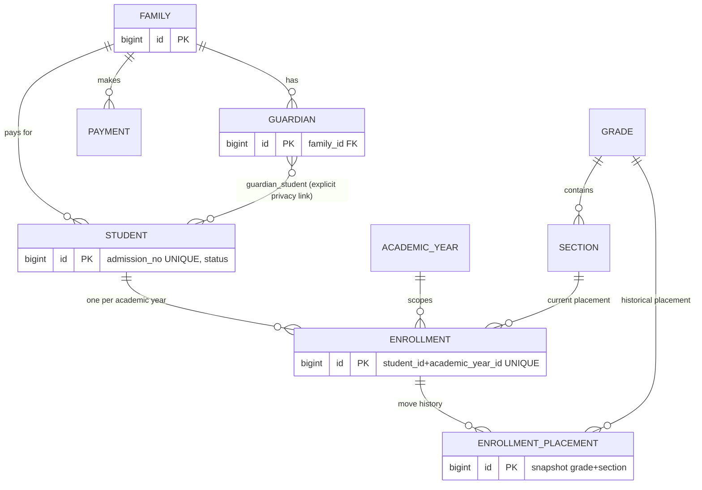
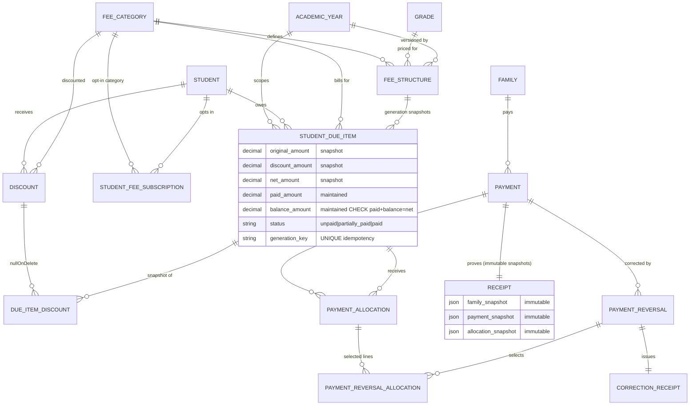
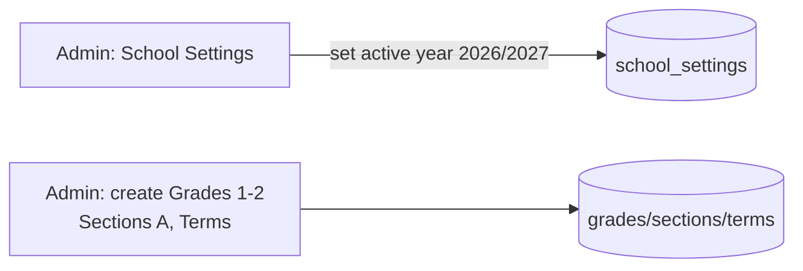
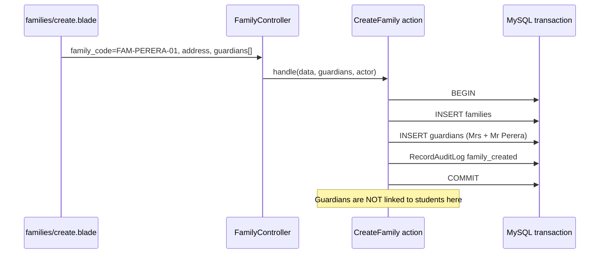
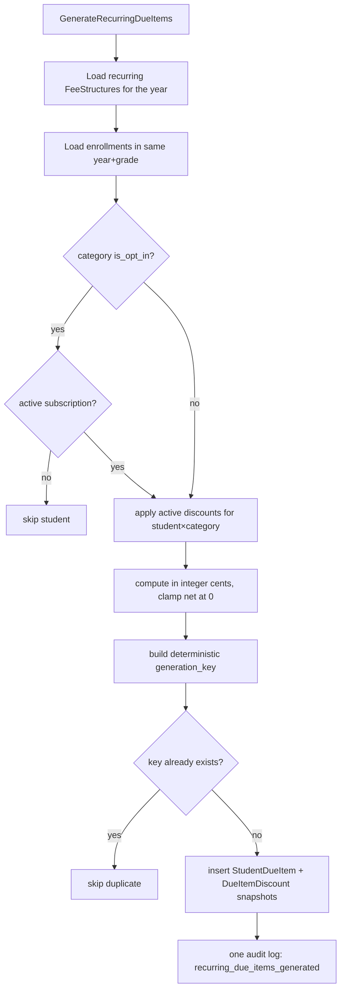

# Skooly — Full Project Knowledge Recovery & Developer Handover Report

**Prepared for:** the returning Skooly developer
**Report date:** 2026-10-21
**Repository state at review time:** branch `main`, clean working tree, HEAD = `ca159db` ("docs: add commercial readiness roadmap"), in sync with `origin/main`. Full history: 56 commits.
**Review type:** read-only code inspection. No application code, migrations, routes, tests, seeders, or checkpoint files were modified. No database commands were run.

**How claims are labelled in this report:**

| Label | Meaning |
|---|---|
| ✅ **Verified (code)** | I read the actual file/method in this repository during this review and cite it. |
| 📄 **Documented only** | Comes from `.ai/context/*`, `docs/*`, or git history. Not re-verified by execution in this session. |
| ⚠️ **Stale/contradicted** | Documentation exists but disagrees with current code. **Code wins.** |
| ❓ **Unverifiable** | Cannot be checked from this repository (e.g., no source file exists). |

**Verification attempted in this session:** a fresh test run was attempted on 2026-10-21 and **failed to start** — this machine's only PHP (WAMP `php8.4.0`) is older than the `>= 8.4.1` required by the locked Symfony 8.1 packages (`vendor/composer/platform_check.php` throws before Artisan, PHPUnit, or PHPStan can run). Details and the fix are in Chapters 12 and 13. The latest **documented** green run is 520 tests / 2622 assertions on 2026-10-08 (📄).

---

## Table of Contents

1. [PROJECT OVERVIEW](#1-project-overview)
2. [TECHNOLOGY AND ARCHITECTURE](#2-technology-and-architecture)
3. [PROJECT FOLDER GUIDE](#3-project-folder-guide)
4. [COMPLETE MODULE INVENTORY](#4-complete-module-inventory)
5. [DATABASE DESIGN](#5-database-design)
6. [COMPLETE SYSTEM DATA FLOW](#6-complete-system-data-flow)
7. [REAL-LIFE ADMIN USER JOURNEY](#7-real-life-admin-user-journey)
8. [BACKEND VS FRONTEND FEATURE PARITY](#8-backend-vs-frontend-feature-parity)
9. [SECURITY AND BUSINESS RULES](#9-security-and-business-rules)
10. [COMPLETED DEVELOPMENT HISTORY](#10-completed-development-history)
11. [REMAINING FEATURES AND OPEN DECISIONS](#11-remaining-features-and-open-decisions)
12. [TESTING AND QUALITY](#12-testing-and-quality)
13. [LOCAL DEVELOPMENT GUIDE](#13-local-development-guide)
14. [HOW TO DEVELOP A FEATURE](#14-how-to-develop-a-feature)
15. [RECOMMENDED ROADMAP](#15-recommended-roadmap)
16. [MY LEARNING PLAN (7 DAYS)](#16-my-learning-plan-7-days)
17. [GLOSSARY](#17-glossary)
18. [START HERE SUMMARY](#18-start-here-summary)

---

# 1. PROJECT OVERVIEW

## 1.1 What Skooly is designed to do

Skooly (✅ `AGENTS.md`, ✅ `docs/system-overview.md`) is a **single-school, single-tenant school-management web application** built in Laravel. It is the digital version of a school office: it registers families and students, places students into classes year after year, computes what each family owes, records payments safely, tracks school events, prepares end-of-year promotion, and leaves an audit trail of who did what.

Stage 1 scope (✅ `.ai/guidelines/skooly-domain.md`, ✅ `docs/commercial-readiness-roadmap.md` §7) covers exactly these areas:

- Academic setup (years, terms, grades, sections, subjects)
- Staff accounts (users, roles, teacher qualifications and assignments)
- Registration (families, guardians, students, enrollments, placement history)
- Money (fee categories/structures, discounts, opt-in subscriptions, due generation, payments, receipts, reversals, dues reporting, reminders)
- School life (events with charges and participation)
- End-of-year promotion (draft → confirm batches)
- Governance (append-only audit logs, archive/restore of academic setup)

**Explicitly out of Stage 1 scope** (📄 `docs/commercial-readiness-roadmap.md` §7): attendance, timetables, exams/report cards, API/mobile apps, online payment gateways, multi-school tenancy. None of these exist in any form in the codebase (✅ no models/migrations/routes for them).

## 1.2 School problems it solves

| Real school problem | How Skooly solves it | Evidence |
|---|---|---|
| Student records scattered across papers/Excel | One `Family` → `Student` → year-specific `Enrollment` model with globally unique admission numbers | ✅ `database/migrations/2026_09_29_185914_create_students_table.php`, ✅ `..._create_enrollments_table.php` |
| "Which class was Nimal in 2026?" — history overwritten each year | Grade/section live on `Enrollment` (per academic year), never on `Student`; moves append `EnrollmentPlacement` rows | ✅ `app/Models/Enrollment.php:93-117` (`placeIn()`) |
| Fees re-priced mid-year changing old bills | Every due item **snapshots** description/amounts; receipts and discount snapshots are immutable JSON/historical rows | ✅ `student_due_items` migration (✅ `original_amount`, `discount_amount`, `net_amount`), ✅ `receipts` migration (`family_snapshot`, `payment_snapshot`, `allocation_snapshot`) |
| Payment applied to the wrong bill / double-entry errors | Family-level `Payment` must be **manually allocated** line-by-line; totals must balance exactly; row locks prevent races | ✅ `app/Models/Payment.php:53-146` (`recordManual`) |
| "Who changed this?" disputes | Append-only `audit_logs` written inside the same DB transaction as the change | ✅ `app/Actions/Audit/RecordAuditLog.php`, ✅ `Payment.php:154-183` |
| One parent seeing another parent's data | Guardian visibility only through explicit `guardian_student` links — family membership grants nothing | ✅ `app/Actions/Privacy/AuthorizeGuardianStudentAccess.php` |
| Accidental deletion of financial history | `restrictOnDelete` on all money/history tables; configuration is archived, not deleted | ✅ migrations for payments/due items/enrollments, ✅ `SetAcademicRecordArchived` |
| End-of-year promotion errors | Draft → confirm batches, atomic confirmation, source-year enrollments never touched | ✅ `app/Actions/Promotion/ConfirmPromotionBatch.php` |

## 1.3 Scope of Stage 1

Per (📄 `.ai/context/phase-status.md`) the Stage 1 slice is: **Admin-driven school administration with Accountant finance support and Teacher accounts that exist but have no operational access yet.** No parent (Guardian) login exists; privacy helpers are ready but unused by any screen (✅ `app/Actions/Privacy/*` have no controller references).

## 1.4 Current development stage

**Where it is right now** (✅ verified against git + code + (📄 `.ai/context/phase-status.md`)):

- Backend domain Phases 1–9 complete (models, actions, policies, tests).
- Web layer Phases 10B-1 through 10B-10 complete (every major workflow has screens).
- Demo data + docs + commercial UI (10C-1…5) complete.
- Admin CRUD completion wave **10D-1A → 10D-9 + Archive workflow + Audit workflow** complete **and committed** (working tree clean; commits `1891bf6`, `dab9034`, `deef8f5`, `60007d9`, `bb27137`, `4cf641f`, `d1e7672`, `d71e5a2`, `fbd5d14`, `ae6bbd7`, `ff8731f`, `719fc6f`, `0c795da`, `1930a57`, `d8bc6ca` all exist in `git log`). ✅
- **Roadmap Step 2 security hardening** complete (`1a7ddb8`): login throttling, password reset, email verification, TOTP 2FA, MySQL money CHECK constraints. ✅ `routes/web.php:48-84`, ✅ `database/migrations/2026_10_07_212728_*`, ✅ `tests/Feature/TwoFactorAuthenticationTest.php`.
- Latest commit is documentation only (`ca159db`, `docs/commercial-readiness-roadmap.md`). ✅
- Phase tracker says current phase = "Roadmap Step 2 Security Hardening … complete / pending commit" — the "pending commit" wording is stale; everything is committed (✅ clean `git status`).

## 1.5 What already works (each verified in code)

1. **Authentication**: session login/logout with rate limiting, forgot/reset password, email verification, TOTP two-factor with recovery codes — ✅ `app/Http/Controllers/Auth/*`, ✅ `routes/web.php:48-84`.
2. **Authorization**: `role` middleware + 8 policies + FormRequest `authorize()` checks — ✅ `bootstrap/app.php:16-18`, ✅ `app/Policies/*`.
3. **Academic setup UI**: CRUD + archive/restore for academic years, terms, grades, sections; school settings with active-year selection — ✅ `routes/web.php:98-124`, ✅ `AcademicYearController` et al.
4. **Identity/staff UI**: users (create/edit, is_active, Superadmin safeguards), subjects (with delete guard), teacher qualifications/assignments — ✅ `routes/web.php:87,110-122`.
5. **Registration UI**: families, guardians, students, guardian links/unlinks, enrollment placement history — ✅ `routes/web.php:127-151`.
6. **Fees UI**: fee categories, fee structures (locked after use), discounts (apply/deactivate), opt-in subscriptions (create/end) — ✅ `routes/web.php:153-184`.
7. **Due generation**: manual recurring + event generation with idempotency keys — ✅ `routes/web.php:186-193`, ✅ `app/Actions/Fees/GenerateRecurringDueItems.php`.
8. **Dues dashboard**: filterable read-only report of stored balances — ✅ `app/Actions/Reports/BuildDuesDashboardReport.php`.
9. **Payments**: manual family-level collection with per-item allocation (Admin + finance-only Accountant flow), payment/receipt history with search/sort/pagination, receipt detail + Admin PDF download — ✅ `Payment::recordManual`, ✅ `routes/web.php:242-264`.
10. **Payment reversals**: Accountant requests itemized partial reversals, Admin approves (four-eyes), correction receipts — ✅ `app/Actions/Payments/*`, ✅ `routes/web.php:266-276`.
11. **Events**: CRUD, per-grade charges (locked after generation), participation, event due generation — ✅ `routes/web.php:195-217`.
12. **Reminders**: internal outbox generation/preview/cancel (nothing ever sent) — ✅ `routes/web.php:219-224`.
13. **Promotion**: draft creation, per-item editing, confirm (atomic), discard — ✅ `routes/web.php:226-239`.
14. **Audit logs**: Admin-only list/filter/show/CSV/PDF export, append-only, forever retention — ✅ `routes/web.php:93-96`.
15. **Demo environment**: idempotent demo seeder guarded against production — ✅ `database/seeders/DemoDataSeeder.php`, ✅ `docs/local-demo.md`.
16. **Quality gates**: 49 test files (510 `it()`/`test()` definitions), PHPStan (Larastan) level config in `phpstan.neon`, Pint, Composer audit — ✅ directory listings; 📄 last green run 520 tests / 2622 assertions (2026-10-08).

## 1.6 What is incomplete

| Gap | Status | Evidence |
|---|---|---|
| Guardian portal (parent login/visibility) | **Missing** — privacy actions exist, zero UI/routes | ✅ no guardian routes in `routes/web.php`; ✅ `app/Actions/Privacy/*` unused by controllers |
| Teacher operational access | **Missing by design decision** — Teacher role can log in but is denied everywhere | ✅ no `role:Teacher` route groups; ✅ policies return nothing for Teacher |
| Reminder delivery (email/SMS/WhatsApp) | **Missing** — records are written to an outbox table only | ✅ `payment_reminders` migration + (📄 phase-status "internal outbox") |
| Scheduler/cron for due generation | **Missing** — generation is a manual Admin button | ✅ no scheduler entries; ✅ `DueGenerationController` is the only entry |
| Payment edit/delete, cash refunds | **Deferred** — reversals exist; real refunds are a pending business decision | (📄 `open-business-decisions.md`, ✅ no mutation routes beyond reversal approve) |
| Receipt numbering policy | **Unresolved** — operator types receipt numbers manually | ✅ `StoreManualPaymentRequest` `receipt_no: required|unique` |
| Teacher assignment correction/removal | **Partial** — list/create/view only, no edit or archive | (📄 phase-status Phase 10D-2 rules; ✅ no update/delete routes for assignments) |
| Hosting, backups, monitoring, UAT | **Missing entirely** | 📄 `docs/production-gap-register.md` GAP-01/02/21/22 |
| SRS document | ❓ **Not present in repo** — referenced by `AGENTS.md` but no file matches `**/*srs*` | ❓ glob returned empty |

## 1.7 Readiness verdict

> **Demo-ready ✅ and internal-test-ready ✅ — NOT production-ready ❌.**

Evidence for demo/internal-test readiness:
- Full Admin workflow works end-to-end per (📄 Phase 10B-10 manual QA) and `tests/Feature/WebManualQaRegressionTest.php` (✅ file exists, 8 methods).
- Deterministic demo data covering every screen: `DemoDataSeeder` (✅ verified content: 3 users, 2 years, 2 families, 3 students, dues, payment, event, reminders, draft promotion batch).
- Security baseline hardened: throttling, password reset, verification, TOTP 2FA, DB money constraints (✅ code verified).

Evidence against production readiness (all ✅ verified as absent, and (📄) `docs/commercial-readiness-roadmap.md` §4 says the same):
1. No hosting/domain/TLS/backup/monitoring configuration anywhere in the repo; `docs/production-gap-register.md` GAP-01/21 are Blockers.
2. No real production Admin account procedure — demo credentials `admin@skooly.test` / `password` are the only documented accounts (✅ `DatabaseSeeder`).
3. No real-user acceptance testing — only developer QA (📄 GAP-22).
4. Reminders never deliver; no scheduler — fees can be forgotten (✅ (📄) GAP-10/11).
5. The local verification toolchain is currently broken on this machine (PHP 8.4.0 < required 8.4.1) — see Chapter 12. A green suite cannot be reproduced here until PHP is upgraded.

Do not treat this as "it has passed production-grade testing" — the last full suite ran on 2026-10-08 and could not be re-run during this review.

---

# 2. TECHNOLOGY AND ARCHITECTURE

## 2.1 Actual versions (verified)

| Component | Version | Source |
|---|---|---|
| PHP | `^8.3` required; **installed CLI = 8.4.0 (WAMP)**; locked Symfony deps require **≥ 8.4.1** ⚠️ | ✅ `composer.json:12`, ✅ `php -v`, ✅ `composer.lock` (16 symfony/* packages at `>=8.4.1`) |
| Laravel | `^13.17` (Laravel 13) | ✅ `composer.json:14` |
| Database | MySQL (local/prod per `.env.example` keys `DB_CONNECTION/HOST/PORT/DATABASE/...`); **SQLite in-memory for tests** | ✅ `.env.example` key names only (no values inspected), ✅ `phpunit.xml` |
| Test framework | Pest `^5.2` (PHPUnit-based), `pest-plugin-laravel ^5.0` | ✅ `composer.json:27-28` |
| Static analysis | Larastan `3.12` (PHPStan), config in `phpstan.neon` | ✅ `composer.json:21`, ✅ `phpstan.neon` |
| Formatter | Laravel Pint `^1.27` | ✅ `composer.json:24` |
| PDF | `dompdf/dompdf ^3.1` (local HTML → PDF; no remote assets) | ✅ `composer.json:13` |
| 2FA | `spomky-labs/otphp ^11.5` (TOTP) | ✅ `composer.json:16` |
| Docs/assist | `laravel/boost ^2.2` (dev), `laravel/pail` | ✅ `composer.json:22-23` |
| Frontend tooling | Vite 8 + Tailwind 4 exist in `package.json` **but are not used by the admin UI** | ✅ `package.json`, ✅ `layouts/app.blade.php` loads `asset('css/admin.css')` |

## 2.2 MVC structure — but with a twist

Skooly follows Laravel MVC and adds one consistent extra layer:

```
Blade view (form) → Route → Controller (thin!) → FormRequest (validates + authorizes)
                                          ↓
                              Action class (all business rules, DB transaction, audit)
                                          ↓
                              Eloquent Model (+ DB constraints as the last line of defence)
```

Rules enforced everywhere (✅ spot-checked across controllers):
- Controllers **never** contain business rules. Example: `FeeCategoryController::store()` just resolves the validated request and calls `CreateFeeCategory::handle()` (✅ `app/Http/Controllers/Web/FeeCategoryController.php`).
- All multi-write workflows run inside `DB::transaction` (✅ e.g., `Payment.php:79`, `Enrollment.php:97`, `app/Actions/Promotion/ConfirmPromotionBatch.php`).
- Controllers never write audit logs — only Actions call `RecordAuditLog` (✅ `(📄 phase-status` + ✅ grep of `RecordAuditLog` usage: only in `app/Actions/*` and `app/Models/Payment.php`).

Two namespace quirks to remember (✅ verified):
- `App\Academic\{ActiveAcademicYear, CreateTerm}` and `App\Teachers\{CreateTeacherAssignment, CreateSectionYearAssignment}` are workflow classes **outside** `app/Actions`.
- `Payment::recordManual()` (model static) and `Enrollment::placeIn()` (model method) are model-level entry points with no Action wrapper.

## 2.3 Modular monolith organization

One deployable Laravel app, organized by domain folder rather than microservices (✅ directory listing):

- `app/Actions/{Academic,Audit,Discounts,Events,Families,Fees,Guardians,Notifications,Payments,Privacy,Promotion,Reports,Students}` — 32 Action classes, one file per workflow.
- `app/Http/Controllers/Web` — 31 controllers grouped loosely by module; `Auth` — 4 controllers.
- `app/Models` — 36 Eloquent models, plain and thin (relationships + casts + the two model-level workflows above).
- `app/Policies` — 8 policies; `app/Http/Middleware` — 1 custom middleware.
- `database/migrations` — 48 migrations; `resources/views` — 111 Blade files.

## 2.4 Layer responsibilities (with real examples)

| Layer | Responsibility | Real example |
|---|---|---|
| **Migration** | Defines table + constraints; the last line of defence | `student_due_items` has `unique(generation_key)` and a CHECK `paid_amount + balance_amount = net_amount` (✅ `2026_10_07_212728_add_amount_checks_...php:44-56`) |
| **Model** | Relations, casts, and (only where justified) the authoritative workflow | `Payment::recordManual()` enforces balance/ownership inside a transaction (✅ `Payment.php:53-146`) |
| **Action** | One business workflow; transaction; audit | `GenerateRecurringDueItems::handle($academicYear, $dueDate, $cycleKey, $actor)` (✅ signature from inventory) |
| **FormRequest** | `rules()` validation **and** `authorize()` role/policy gate | `StoreManualPaymentRequest::authorize()` → `can('create', Payment::class)`; rules require `receipt_no` unique, `amount` min 0.01, ≥1 allocation (✅ request inventory) |
| **Controller** | HTTP glue only: resolve request → call Action → redirect/render | `DueGenerationController::recurringStore` → `GenerateRecurringDueItems::handle` (✅ controller inventory) |
| **Policy** | Per-record permission matrix for `Gate`/`can` | `PaymentReversalPolicy::approve()` — Admin only and never the original requester (✅ inventory) |
| **Route** | URL + middleware group | `Route::resource('grades', GradeController::class)->except('destroy')` inside `role:Admin` group (✅ `routes/web.php:100`) |
| **Blade view** | Display + form; **no money math** | Dashboard renders report strings as-is (✅ `(📄 phase-status` "no recalculation in Blade" + `DuesDashboardController` passes array straight through) |
| **Middleware** | `EnsureUserHasRole` aliased as `role` | `bootstrap/app.php:16-18` (✅) |

## 2.5 Authentication and authorization design

**Authentication** (✅ all in `app/Http/Controllers/Auth/` + `routes/web.php:48-84`):
1. `POST /login` → `LoginRequest::authenticate()` with a rate limiter: **5 failed attempts per normalized email+IP per minute**, cleared on success.
2. If the user has confirmed TOTP: password accepted first, session stashed with `two_factor_login_id`, redirect to `/two-factor-challenge`; login stays unauthenticated until a valid 6-digit code or unused recovery code (hashed, single-use, consumed under `lockForUpdate`) completes a rate-limited challenge (5/60s) and regenerates the session.
3. Email verification: `MustVerifyEmail` + signed links; **every protected route group requires `verified`** middleware.
4. Password reset: Laravel password broker with opaque responses (same message for existing/unknown email).
5. 2FA disable requires current password **and** a valid second factor.

**Authorization** — three stacked gates (✅ verified pattern):
1. **Route middleware** — `['auth', 'verified', 'role:Admin']` etc. `EnsureUserHasRole` redirects guests to login and 403s wrong roles (✅ `app/Http/Middleware/EnsureUserHasRole.php`).
2. **FormRequest `authorize()`** — repeated role/policy check as defence in depth; **all 56 Web requests check a role or policy** (✅ request inventory — no Web request returns blanket `true`).
3. **Policies** for record-level checks where routes use `->can(...)` (✅ `routes/web.php:245,248,251` use `->can('create', Payment::class)`).

Role matrix (full detail in Chapter 9):

| | Superadmin | Admin | Accountant | Teacher |
|---|---|---|---|---|
| Web access | User management only | Everything | Finance-only (dues dashboard, payment/receipt history+detail, collect via exact family code, reversal request, reminder read) | **None** (login only) |
| Guardian | not a web user — no Guardian→User link exists at all (✅ no table/relation) | | | |

## 2.6 Frontend CSS/JavaScript architecture

- **No build step for the admin UI.** The layout links `asset('css/admin.css')` — a single hand-written 1,809-line design system with `:root` tokens (✅ first lines verified) — and `asset('js/admin-ui.js')` with `defer` (✅ `resources/views/layouts/app.blade.php`).
- `public/js/admin-ui.js` (250 lines) is progressive enhancement: toast notifications fed by `partials/flash.blade.php` hidden divs, `data-confirm` native confirm dialogs on irreversible-looking actions, and `data-loading` submit-button disabling. **If it fails to load, forms still submit normally** (✅ script design + (📄 10C-4 rules)).
- The Vite/Tailwind pipeline exists (`npm run build` works) but `public/build` is gitignored, so the project deliberately does not depend on it — every page would break on fresh checkout (📄 `(current-architecture.md` "Admin Interface" section, ✅ `.gitignore` rationale documented).
- 10 reusable Blade components: `alert, button-link, card, empty-state, form-section, list-search, page-header, pagination, stat-card, status-badge` (✅ `resources/views/components/*`).

## 2.7 One HTTP request, end to end (real example: recording a school payment)

Admin opens a Family page and submits **Record payment**:

```
1. Browser submits POST /families/{family}/payments
   Route: routes/web.php:250-252
     ->middleware(['auth','verified','role:Admin,Accountant'])
     ->can('create', Payment::class)          ← PaymentPolicy gate
   name: families.payments.store

2. Laravel resolves StoreManualPaymentRequest (app/Http/Requests/Web/)
   authorize(): can('create', Payment::class)  ← second gate (defence in depth)
   rules(): receipt_no required+unique,
            amount numeric min 0.01,
            allocations array min 1 with exists(student_due_item_id) per item,
            allocations.*.amount numeric  ← friendly pre-check

3. PaymentCollectionController::store() (app/Http/Controllers/Web/)
   - For Accountant (not Admin): aborts 403 unless the Family matches the
     session key set by /payments/collect (exact family-code lookup)  ← privacy guard
   - Delegates to Payment::recordManual(...)   ← NO logic in controller

4. Payment::recordManual() (app/Models/Payment.php:53)
   - Converts every amount to integer cents (toCents)          ← no float math
   - Requires paymentAmount > 0 and Σ allocations == paymentAmount (line 75)
   - DB::transaction:
       • creates Payment row (family_id, paid_at, method, amount)
       • per allocation: StudentDueItem lockForUpdate()
           - ownership check: due item's family must equal paying family (line 97)
           - balance check: allocation ≤ balance_amount (line 104)
           - updates paid_amount / balance_amount / status
               (unpaid → partially_paid → paid; zero balance exactly)
           - creates PaymentAllocation row
       • creates Receipt with family/payment/allocation JSON snapshots (line 133)
       • RecordAuditLog: payment_recorded + payment_allocation_recorded per line (line 142)
   - MySQL CHECK guarantees paid + balance = net even if code had a bug

5. Response: redirect back with session flash
   → layouts/app.blade.php includes partials/flash.blade.php
   → admin-ui.js turns the hidden flash div into a dismissible toast
```

Every step above was verified by reading the cited file. The same shape (Route → FormRequest → thin controller → Action/model → transaction + audit → flash) repeats across the whole application.

---

# 3. PROJECT FOLDER GUIDE

## 3.1 The map

```
skooly/
├── app/
│   ├── Academic/            ← 2 workflow helpers OUTSIDE Actions/
│   │   ├── ActiveAcademicYear.php     (the active-year guard, used by many actions)
│   │   └── CreateTerm.php
│   ├── Actions/             ← ALL business workflows (32 files, 13 subfolders)
│   ├── Console/Commands/    ← 1 command: users:make-superadmin
│   ├── Http/
│   │   ├── Controllers/Auth/    ← 4 auth controllers (login, reset, verify, 2FA)
│   │   ├── Controllers/Web/     ← 31 thin admin controllers
│   │   ├── Middleware/           ← EnsureUserHasRole (alias "role")
│   │   └── Requests/{Auth,Web}/  ← 6 + 56 FormRequests (validation + authorization)
│   ├── Models/              ← 36 Eloquent models (thin; 2 carry workflows)
│   ├── Policies/            ← 8 policies (Student, Payment, Receipt, …)
│   └── Teachers/            ← 2 assignment helpers (CreateTeacherAssignment,
│                               CreateSectionYearAssignment)
├── bootstrap/app.php        ← middleware alias registration, route wiring
├── config/  database/  public/  resources/  routes/  storage/  tests/
├── database/
│   ├── migrations/          ← 48 migrations (the schema bible)
│   ├── factories/           ← 36 factories (tests create data through these)
│   └── seeders/             ← DatabaseSeeder (minimal) + DemoDataSeeder (demo world)
├── docs/                    ← 15 hand-written docs incl. THIS report
├── .ai/context/             ← checkpoint files (phase status/history, open decisions)
├── .ai/guidelines/          ← skooly-domain.md (domain rules)
├── routes/web.php           ← the ONLY route file that matters (no api.php usage)
├── public/css/admin.css     ← the entire admin design system (no build step)
├── public/js/admin-ui.js    ← toasts, confirms, submit-locking (no build step)
└── resources/views/         ← 111 Blade files; layouts/app.blade.php is the shell
```

## 3.2 Directory-by-directory: what it is and when you look at it

| Directory | What lives there | Look here when… |
|---|---|---|
| `app/Models` (36 files) | Tables as objects: relations, casts, 2 embedded workflows | You need a relation ("does X have many Y?"), a status constant, or money helpers (`Payment::toCents`) |
| `app/Actions` (32 files) | One class per business operation: `handle()` + `DB::transaction` + audit | **Start every feature investigation here.** This is where the real rules live |
| `app/Http/Controllers/Web` (31) | HTTP glue: resolve request → call Action → redirect | You're tracing a URL to its logic, or a controller-only guard (users, accountant session guard) exists |
| `app/Http/Requests/Web` (56) | `rules()` + **`authorize()` role checks** | You're adding/validating a form field, or asking "who may do this?" |
| `app/Policies` (8) | Record-level permission matrices | A route uses `->can(...)`, or you're changing role capabilities |
| `app/Http/Middleware` (1) | `EnsureUserHasRole` → alias `role` (✅ `bootstrap/app.php:16-18`) | You're adding a new protected route group |
| `app/Academic` | `ActiveAcademicYear` — enforces "new work must target the active year" | Any write flow touches years; `current()`, `ensure()`, `validationRule()` |
| `app/Teachers` | Teacher assignment creation with role/qualification checks | Changing how teaching assignments are made |
| `database/migrations` (48) | Schema + constraints (`restrictOnDelete`, CHECKs, uniques) | Before changing any data shape; also your ERD source (Chapter 5) |
| `database/seeders` | `DatabaseSeeder` (roles + 1 admin), `DemoDataSeeder` (full demo) | Setting up a local world; both refuse to run in production |
| `database/factories` (36) | Test data builders; 3 have states (`UserFactory::unverified/teacher`, `RoleFactory::admin/accountant/teacher`, `TeacherAssignmentFactory::configure`) | Writing tests |
| `resources/views` (111) | Blade: `layouts/app.blade.php` shell, `components/*` (10), `partials/flash`, per-module folders, 2 PDF views | Changing UI; forms POST to named routes |
| `routes/web.php` (276 lines, 129 route statements) | Every URL, name, middleware group, and `->can` gate | Always — route name + middleware are the contract |
| `public/css/admin.css`, `public/js/admin-ui.js` | Static admin styling/behaviour (deliberately build-free) | Styling or UX work; no npm needed |
| `tests/` (49 `*Test.php`) | Pest feature tests (48) + 1 placeholder unit test; `Pest.php` registers helpers `adminUser()`, `userWithRole()`, `setActiveAcademicYear()` | Verifying any behavior change |
| `docs/` | `system-overview`, `data-flow`, `user-workflows`, `local-demo`, `production-gap-register`, `security-review`, parity/CRUD audits, `commercial-readiness-roadmap` | Reading intent — **but cross-check against code**; some are partially stale (see §1.7 and Chapter 11) |
| `.ai/context/` | Checkpoints: `phase-status`, `phase-history`, `current-architecture`, `open-business-decisions`, `verification-history` | Recovering decisions; treat as **notes, not truth** where they conflict with code |

## 3.3 Golden rule for where to work

> **Want to change behavior? → `app/Actions` (or the model workflow for payments/placement).**
> **Want to change who can do it? → FormRequest `authorize()` + route middleware (+ policy if `can()`-gated).**
> **Want to change what a form accepts? → FormRequest `rules()` + Blade view.**
> **Want to change stored data? → migration + model + every Action that writes it + tests.**
> **Never** put business rules in a controller or Blade file — that is a project convention with tests around it (✅ `(📄 phase-status` "No business rule lives in a controller or a view" + controller inspection).

---

# 4. COMPLETE MODULE INVENTORY

> Status vocabulary: **Implemented** = backend + web UI + tests. **Partial** = exists but with named limits. **Deferred** = deliberately not built yet (decision pending). **Missing** = nothing exists. Tests are cited by file; method counts come from my static census (✅).

## 4.1 School Settings

- **Purpose:** a singleton row holding `active_academic_year_id` — "the year the school is currently operating in". Every *new* year-scoped workflow must target it.
- **Table/model:** `school_settings` → `SchoolSetting` (✅ migrations + model).
- **Fields:** `active_academic_year_id` (FK → academic_years).
- **Actions:** none (controller writes directly). Enforcement lives in `App\Academic\ActiveAcademicYear` — `current()` throws if missing/archived, `ensure()` rejects non-active years, `validationRule()` feeds forms (✅ `app/Academic/ActiveAcademicYear.php`).
- **Routes/UI:** `GET/PUT /school-settings` (edit/update only), Admin-only — ✅ `routes/web.php:123-125`; view `resources/views/school-settings/edit.blade.php`; request `UpdateSchoolSettingRequest` (accepts only active, non-archived years).
- **Status:** **Implemented** (was historically "inert" per (📄 10C-5) — it is now enforced, ✅ `ActiveAcademicYear::ensure` called by `Enrollment::placeIn()` and generation actions; verified by `tests/Feature/ActiveAcademicYearEnforcementTest.php`, 4 methods).
- **Safety:** current active year cannot be archived; archived years excluded from the selector (✅ `AcademicYearController::archive` guard).
- **Remaining problems:** none known; historical reads intentionally ignore it (by rule).

## 4.2 Academic Years and Terms

- **Purpose:** the time spine of the school; every enrollment, fee structure, event, reminder, and promotion references a year. Terms subdivide a year (✅ `terms.academic_year_id`).
- **Tables/models:** `academic_years` (`name` unique, start/end dates, `is_archived`), `terms` (`name` unique per year, dates, `is_archived`).
- **Actions:** `Academic\CreateTerm` (guards active year), `Academic\SetAcademicRecordArchived` (archive/restore + audit) (✅).
- **Routes/UI:** `resource('academic-years')->except('destroy')` + `archive`/`restore` POSTs; same for `terms` — ✅ `routes/web.php:98-105`; views `academic-years/{index,create,show,edit}`, `terms/*`; requests `Store/UpdateAcademicYearRequest`, `Store/UpdateTermRequest`, `ArchiveAcademicRecordRequest`.
- **UI actions:** list (search/sort/paginate), create, view, edit, **archive, restore**. No delete route (deliberate).
- **Status:** **Implemented.**
- **Tests:** `WebAcademicSetupTest` (14), `AcademicFoundationTest` (7), `ActiveAcademicYearEnforcementTest` (4).
- **Safety:** delete impossible at DB level (restrict FKs from enrollments/fee structures); archive preserves history and never cascades to children (✅ rules + `SetAcademicRecordArchived`).
- **Remaining problems:** archive semantics for *reports* were a past open decision but resolved: archived records are hidden only from **new selections** (✅ `(open-business-decisions.md` "Academic Archive Workflow Rules").

## 4.3 Grades and Sections

- **Purpose:** the class structure. Grade = "Grade 1"; Section = "Grade 1 / A". `sections` carries its own `grade_id` with a composite unique `(grade_id, name)` (✅ `..._create_sections_table.php` + `..._add_grade_id_id_unique_index_to_sections_table.php`).
- **Tables/models:** `grades` (`name` unique, `sequence_order` unique — drives promotion's "next grade"), `sections` (`grade_id`, `name`, capacity), both with `is_archived`.
- **Actions:** `SetAcademicRecordArchived` shared archive action.
- **Routes/UI:** `resource('grades')`/`resource('sections')` minus destroy + archive/restore — ✅ `routes/web.php:100-109`; views `grades/*`, `sections/*` incl. `partials/form`.
- **UI actions:** list/create/view/edit/archive/restore. No delete.
- **Status:** **Implemented.**
- **Tests:** `WebAcademicSetupTest`, `AcademicFoundationTest`.
- **Safety:** `sections.grade_id` participates in composite FKs from `enrollments` (✅ `enrollments` migration lines 23-26) so a section can never be moved to another grade while referenced; archiving does not cascade.
- **Remaining problems:** none known.

## 4.4 Users and Roles

- **Purpose:** staff accounts. **Roles are fixed constants, not data**: Superadmin, Admin, Accountant, Teacher (✅ `app/Models/Role` constants; there is **no role CRUD** — by rule, (📄 10D-2 rules)).
- **Tables/models:** `users` (`email` unique, `password`, `email_verified_at`, `is_active`, TOTP columns: `two_factor_secret`, `two_factor_confirmed_at`, `two_factor_recovery_codes`), `roles`, pivot `role_user` — ✅ migrations `2026_10_07_094959_add_is_active_to_users_table.php`, `2026_10_08_011657_add_two_factor_authentication_to_users_table.php`, `..._create_roles_table.php`, `..._create_role_user_table.php`. Users may hold multiple roles (✅ `role_user` pivot).
- **Actions:** none — `UserController` writes directly with heavy in-controller guards.
- **Routes/UI:** `Route::resource('users')->except('destroy')` under `role:Admin,Superadmin` — ✅ `routes/web.php:86-88`; views `users/*`; requests `StoreUserRequest`, `UpdateUserRequest` (policy-gated).
- **UI actions:** list/create/view/edit/update. **No delete** — lifecycle is `is_active` (inactive users cannot log in ✅ `LoginRequest`/policy tests).
- **Status:** **Implemented** with safeguards: Superadmin manages all; Admin manages only non-Admin/non-Superadmin users; cannot archive self or the last active Superadmin (✅ `UserController::ensureSuperadminSafeguards`, `(phase-status` 10D-2 rules); first Superadmin via `php artisan users:make-superadmin {email}` (✅ `app/Console/Commands/MakeUserSuperadmin.php`).
- **Tests:** `WebUserManagementTest` (6), `MakeUserSuperadminCommandTest` (2), `WebAuthProtectionTest` (16).
- **Safety:** `UserPolicy::delete/restore/forceDelete` return **false for everyone** (✅ policy inventory) — hard deletion is structurally impossible via HTTP.
- **Remaining problems:** no role editing UI; password change for *another* user exists via `UpdateUserRequest` (nullable confirmed password) — verify intended behavior before using (⚠️ edge case flagged, not audited here).

## 4.5 Teachers, Subjects, Qualifications, Assignments

- **Purpose:** staff qualification and timetable-lite data: which teacher may teach which subject (`teacher_qualifications` pivot via User `qualifiedSubjects`), who teaches subject X in section Y this year (`teacher_assignments`), who is class-in-charge (`section_year_assignments`) — all year-scoped and requiring the `Teacher` role.
- **Tables/models:** `subjects` (code+name unique), `teacher_assignments` (year, section, teacher, subject), `section_year_assignments` (year, section, one teacher), `subject_teacher` pivot (✅ migration list).
- **Actions:** `App\Teachers\CreateTeacherAssignment` (requires Teacher role **and** qualification), `App\Teachers\CreateSectionYearAssignment` (requires Teacher role) (✅).
- **Routes/UI:** subjects = full `resource` **with destroy**; qualifications/assignments = index/create/store/show only — ✅ `routes/web.php:110-122`; views `subjects/*`, `teacher-qualifications/*`, `teacher-assignments/*`, `section-year-assignments/*`.
- **UI actions:** subjects: list/create/view/edit/update/**delete** (delete blocked while referenced by a teaching assignment — ✅ `SubjectController::destroy`); assignments: list/create/view only.
- **Status:** **Partial** — creation and viewing implemented; **correction/removal of assignments is deferred** (📄 10D-2 rules; no update/archive routes exist ✅).
- **Tests:** `WebAcademicStaffManagementTest` (5), `IdentityAndTeacherFoundationTest` (5).
- **Safety:** duplicate unique constraints caught (`QueryException` → validation error ✅ `TeacherAssignmentController::store`); subject deletion guard.
- **Remaining problems:** no assignment edit/replace flow (a wrong assignment currently needs DB work); no audit constants for these flows.

## 4.6 Families and Guardians

- **Purpose:** `Family` = the household registration/billing unit (unique `family_code`, address, contact, `combined_billing_enabled` default true). `Guardian` = a person belonging to **exactly one** Family.
- **Tables/models:** `families`, `guardians` — ✅ `..._create_families_table.php` (fields verified), `..._create_guardians_table.php`.
- **Actions:** `Families\CreateFamily` (family + optional guardians in one transaction, **never** links guardians to students), `Families\UpdateFamily` (only family_code/address/contact/combined_billing; never merges families) (✅).
- **Routes/UI:** families index/create/store/show/edit/update (no delete — ✅ `routes/web.php:127-133`); guardians create under family + show/edit/update (✅ `routes/web.php:138-144`).
- **UI actions:** Family: list (search/sort/paginate), create (nested guardians), view (printable), edit, update. Guardian: create/view/edit/update under a family; **no standalone guardian index** (reached from family page).
- **Status:** **Implemented.**
- **Tests:** `FamilyGuardianTest` (6), `WebRegistrationWorkflowTest` (15), `WorkflowActionsTest` (17).
- **Safety:** deleting a family with guardians/students is DB-restricted (✅ `BackendHardeningTest`); creating/editing a guardian **grants no student visibility** (✅ rule + `WebGuardianStudentManagementTest`); duplicate `family_code` rejected (unique index) but **broader duplicate-family detection is an open decision** (📄 open decisions: warn vs block).
- **Remaining problems:** no guardian delete/archive; `guardian` contact fields intentionally *not* unique (open decision); photo fields deferred.

## 4.7 Students and Enrollments (+ Placement)

- **Purpose:** `Student` belongs to one Family (`admission_no` globally unique, `status` default `pending_registration`). **Grade/section live on `Enrollment`** — one per student per academic year (unique `(student_id, academic_year_id)`), so history is never overwritten. Mid-year moves append `EnrollmentPlacement` rows.
- **Tables/models:** `students`, `enrollments`, `enrollment_placements` (✅ migrations; fields verified).
- **Actions/entry points:** `Students\RegisterStudent` (family + student + optional guardians + optional initial enrollment; validates section-belonging-to-grade; creates **no** due items; does not activate); `Enrollment::placeIn($grade,$section)` — model method that ensures the **active** year, snapshots the old placement on first move, updates current placement, appends new placement row in one transaction (✅ `app/Models/Enrollment.php:93-117`).
- **Routes/UI:** register student under family (`families.students.create/store`), student show/edit/update, guardian link/unlink, placement create/store — ✅ `routes/web.php:134-151`; views `students/{create,show,edit}` (printable show), `enrollments/placements/create`. **No students index** — browsing starts from a family (✅ view tree).
- **UI actions:** register (nested in family), view, edit (never changes family or historical enrollments), link/unlink guardian (confirmed + audited), move section (placement history preserved).
- **Status:** **Implemented.**
- **Tests:** `StudentEnrollmentTest` (10), `WebRegistrationWorkflowTest` (15), `WebEnrollmentManagementTest` (3), `WorkflowActionsTest` (17).
- **Safety:** `Student.grade_id`/`section_id` **must never exist** (open decision forbidden — ✅ rule, and students migration has no such columns); grade-section mismatch rolls back (composite FK ✅); status transitions beyond `pending_registration` → activation-on-payment are **deferred** (no rule exists to identify "registration fees") (📄 10A rules).
- **Remaining problems:** no global student list/search; `gender` is a free string (no SRS value set ❓); `photo_path` nullable but no upload (deferred); no automatic `admission_no` generation.

## 4.8 Guardian–Student Links (privacy module)

- **Purpose:** **the privacy boundary of the entire system.** A Guardian sees a Student only through an explicit row in the `guardian_student` pivot (composite PK, cascade delete — ✅ `..._create_guardian_student_table.php`).
- **Tables/models:** `guardian_student` pivot; `Guardian::students()` / `Student::guardians()` relations.
- **Actions:** `Guardians\LinkGuardianToStudent` (same-family required, idempotent), `Guardians\UnlinkGuardianFromStudent` (transaction + `guardian_student_unlinked` audit) (✅); privacy helpers `Privacy\AuthorizeGuardianStudentAccess`, `Privacy\ListGuardianVisibleStudents`, `Privacy\ListGuardianVisibleDueItems` (✅).
- **Routes/UI:** `POST /students/{student}/guardians`, `DELETE .../guardians/{guardian}` — ✅ `routes/web.php:148-149` (confirmed in UI, audited).
- **Status:** **Backend implemented, consumer missing.** There is no Guardian-facing screen or login; the helpers are verified by tests (`AuthorizationPrivacyTest` 14 methods) but used by nothing in production code (✅ route/controller grep).
- **Tests:** `AuthorizationPrivacyTest` (14), `WebGuardianStudentManagementTest` (4).
- **Safety:** combined billing **never** widens visibility (✅ tests explicitly cover sibling privacy); family membership alone grants nothing.
- **Remaining problems:** the whole Guardian portal (login, pages) is a deferred module (decision: guardian invitation process + exact financial visibility needed).

## 4.9 Fee Categories and Fee Structures

- **Purpose:** `FeeCategory` = kind of charge ("Tuition", "Transport") with `is_recurring` and `is_opt_in` flags. `FeeStructure` = the price list entry: (category × grade × academic year × frequency) → amount, unique per that combination (✅ `fee_structures` migration + `StoreFeeStructureRequest` composite unique).
- **Tables/models:** `fee_categories` (`name` unique, `is_recurring`, `is_opt_in` default false), `fee_structures`.
- **Actions:** `Fees\CreateFeeCategory`, `UpdateFeeCategory`, `CreateFeeStructure`, `UpdateFeeStructure` (✅ signatures per inventory).
- **Routes/UI:** fee-categories index/create/store/edit/update; fee-structures index/create/store/edit/update — ✅ `routes/web.php:153-166`. No delete anywhere.
- **UI actions:** list/search/create/edit; **amount+frequency editable only while no `student_due_item` references the structure** — controller computes `isLocked`, action throws `RuntimeException` (✅ `FeeStructureController::edit/update`, `UpdateFeeStructure`).
- **Status:** **Implemented** (editing was Phase 10D-5, commit `d8bc6ca` "allow unused fee price edits" ✅).
- **Tests:** `WebFeeAndEventChargeEditingTest` (8), `WebFeeDiscountManagementTest` (15), `FeeDueDiscountTest` (13).
- **Safety:** generated dues are never rewritten by config edits (✅ snapshot rule); **no audit constants exist for fee category workflows → unaudited** (documented gap).
- **Remaining problems:** no delete/archive; unaudited; `CreateFeeStructure` intentionally not audited (no constant may be invented — 📄 10A rules).

## 4.10 Discounts and Scholarships

- **Purpose:** a monetary gift attached to **one Student × one FeeCategory** (`Discount`): `value_type` = `amount` or `percentage` (null = amount), optional start/end dates, `is_active`, `discount_type` label (e.g., scholarship). It is **not** applied to existing bills — it is applied at *generation time* and snapshotted.
- **Tables/models:** `discounts` (✅ migration `..._create_discounts_table.php`).
- **Actions:** `Discounts\ApplyStudentDiscount` (creates active discount; never touches existing due items; audited `discount_applied`) (✅).
- **Routes/UI:** create/index/store under student + `POST /discounts/{discount}/deactivate` — ✅ `routes/web.php:168-175`.
- **UI actions:** apply, list per student, **deactivate** (sets `is_active=false`; affects future generation only).
- **Status:** **Implemented.** No sibling/automatic discounts (open decision 📄).
- **Tests:** `FeeDueDiscountTest` (13), `RecurringDueGenerationTest` (13 — clamping to ≥0, percentage math), `WebStudentFinancialLifecycleTest` (3), `WebFeeDiscountManagementTest` (15).
- **Safety:** deactivation never rewrites history (✅ + tests); discount values clamped so `net_amount ≥ 0`; deactivation currently **not audited** (no constant) (📄 10D-3 rules).
- **Remaining problems:** sibling discount rule unresolved (📄); discount lifecycle auditing deferred.

## 4.11 Fee Subscriptions (opt-in fees)

- **Purpose:** opt-in categories (`FeeCategory.is_opt_in = true`, e.g., Transport) only bill students holding an active `StudentFeeSubscription` for that year (✅ `StudentFeeSubscription` + `StoreStudentFeeSubscriptionRequest` requires the category to be `is_opt_in`).
- **Tables/models:** `student_fee_subscriptions` (student, category, year, `is_active`, `starts_on`, `ends_on`), unique per student/category/year (✅ migration).
- **Actions:** `Fees\CreateStudentFeeSubscription` (no due items created) (✅).
- **Routes/UI:** create/index/store + `POST /student-fee-subscriptions/{id}/end` — ✅ `routes/web.php:177-184`.
- **UI actions:** add, list per student, **end** (`is_active=false` + `ends_on`; future generation only).
- **Status:** **Implemented** (creation, ending). No standalone reports; unaudited (no constants) (📄 10D-3).
- **Tests:** `RecurringDueGenerationTest` (opt-in gating), `WebStudentFinancialLifecycleTest` (3), `WebFeeDiscountManagementTest` (15).
- **Safety:** ending never rewrites existing due items; only opt-in categories accepted (double-checked in request **and** action ✅).

## 4.12 Student Due Items and Discount Snapshots

- **Purpose:** the atomic bill line. One `StudentDueItem` = "student X owes Y for (category, cycle) in year Z". It is a **historical snapshot**, never a live view of the fee structure.
- **Tables/models:** `student_due_items` (✅ full migration read):
  - FKs: `student_id`, `academic_year_id`, `fee_category_id`, nullable `fee_structure_id` — all `restrictOnDelete`.
  - Money: `original_amount`, `discount_amount` (default 0), `net_amount` — `decimal(12,2)`; later columns `paid_amount`, `balance_amount` (✅ `2026_09_30_014152_add_payment_balances_to_student_due_items_table.php`).
  - `status` ∈ `unpaid | partially_paid | paid`; nullable `due_date`; **`generation_key` nullable-unique** — the idempotency key.
  - CHECK constraint (✅ `2026_10_07_212728_...`): all amounts ≥ 0 and `paid_amount + balance_amount = net_amount` (SQLite triggers in tests).
- **Discount snapshots:** `due_item_discounts` links a due item to the applied discount with copied values; nullable `discount_id` is **nullOnDelete** so history survives source deletion (✅ `(phase-status` schema decisions + `BackendHardeningTest`).
- **Status:** **Implemented.** Written only by the two generation actions and the payment/reversal paths.
- **Tests:** `FeeDueDiscountTest` (13), `RecurringDueGenerationTest` (13), `StudentDueItemConstraintTest` (1 method, dataset-expanded), `BackendHardeningTest` (11).
- **Safety:** never edited by config changes; DB CHECK + application guards both enforce balance correctness (✅ double protection).
- **Remaining problems:** `due_date` is nullable — items without a date can never be reminded (by rule).

## 4.13 Recurring Due Generation

- **Purpose:** the monthly billing button. Walks every **recurring** `FeeStructure` for an academic year, matches students enrolled in the same year+grade, and creates `StudentDueItem`s with discounts applied and snapshotted.
- **Entry point:** `Fees\GenerateRecurringDueItems::handle(AcademicYear, dueDate, ?cycleKey, ?User actor): int` (✅ signature per inventory). Web trigger: `GET/POST /due-generation/recurring` (✅ `routes/web.php:186-189`).
- **Rules (all verified in tests `RecurringDueGenerationTest`, 13 methods):**
  - Opt-in categories skipped unless the student has an active subscription.
  - Deterministic `generation_key` per (student, category, structure, cycle) → re-running is safe (idempotent).
  - Integer-cents math; discount clamped so net ≥ 0.
  - Transactional; creates **no** payments/receipts; logs **one** audit entry per run (not per row).
- **Status:** **Implemented as a manual Admin action.** No scheduler/cron exists (✅ no console scheduling; (📄 GAP-11)).
- **Remaining problems:** forgetting to click = unbilled fees; no auto-activation of students after paying registration fees (deferred — no rule to identify registration fees, 📄 10A).

## 4.14 Payments and Allocations

- **Purpose:** money from a family, applied to specific bill lines. **Payments are family-level; allocations are per due item and always manual.**
- **Tables/models:** `payments` (✅ migration read: `family_id` restrict, nullable-unique `payment_reference`, `paid_at`, `method`, `amount`, `notes`), `payment_allocations` (`payment_id`, `student_due_item_id`, `amount` — both restrict) (✅).
- **Workflow:** `Payment::recordManual()` — the authoritative transaction (✅ `app/Models/Payment.php:53-146`, walked in §2.7). Guards: amount > 0, Σ allocations == payment, due items belong to the paying family, allocation ≤ current balance, row locks, integer cents, audit rows, receipt snapshot — all in one transaction.
- **Routes/UI:** Admin: from family page (`families.payments.create/store`). Accountant: finance-only `GET /payments/collect` (exact family-code lookup → session-stashed family) then the same store route with a session guard (✅ `PaymentCollectionController::ensureAccountantSelectedFamily`, `routes/web.php:242-254`). History: `GET /payments`, `GET /payments/{payment}` (Admin + Accountant) with search/sort/pagination.
- **Status:** **Implemented** (collection, history). No automatic allocation strategies (open decision 📄); no edit/delete/refund (by design; corrections go through reversals).
- **Tests:** `PaymentReceiptTest` (9), `WebPaymentCollectionTest` (16), `WebAccountantAuthorizationTest` (1), `BackendHardeningTest` (11 — overpayment/sequential-payment cases).
- **Safety:** DB CHECK on the due item side means a buggy allocation literally cannot corrupt balances; sequential payments cannot overpay (✅ tests).
- **Remaining problems:** manual receipt numbering (📄 GAP-12); no auto-allocation (📄 GAP-15).

## 4.15 Receipts

- **Purpose:** an **immutable printed proof** of one payment: one-to-one with `payment_id` (unique), unique manual `receipt_no`, and three JSON snapshots (`family_snapshot`, `payment_snapshot`, `allocation_snapshot`) captured at issue time (✅ `receipts` migration read fully).
- **Routes/UI:** index/show (Admin + Accountant), **Admin-only PDF download** `GET /receipts/{receipt}/pdf` via local Dompdf rendering `resources/views/receipts/pdf.blade.php` from snapshots only (✅ `ReceiptController::downloadPdf`, view tree).
- **Status:** **Implemented** (PDF was Phase 10D-9, commit `ff8731f` ✅). Accountants can view but **cannot download** PDFs (✅ rule + tests).
- **Tests:** `PaymentReceiptTest` (immutability), `WebPaymentCollectionTest` (snapshot display + PDF), `WebCommercialWorkflowUiTest`.
- **Safety:** receipt content is never recalculated from live due items (✅ rule); delete route does not exist; DB restricts deleting a payment that has a receipt.
- **Remaining problems:** numbering policy unresolved (operator types it; DB unique is the only guard).

## 4.16 Payment Reversals and Correction Receipts

- **Purpose:** the approved correction path for mistaken payments — **append-only**. A Payment can have multiple reversals (unique dropped in ✅ `2026_10_07_203847_create_payment_reversal_allocations_table.php:40`); each reversal itemizes selected original allocations via immutable `payment_reversal_allocations` rows (`selected_amount`, unique per reversal×allocation ✅ line 22).
- **Tables/models:** `payment_reversals` (original_payment_id, requester, reason, status `requested→approved`, approver, approved_at), `payment_reversal_allocations`, `correction_receipts` (one-to-one with reversal, unique manual correction receipt no, original-receipt + itemized snapshots) (✅ migrations read).
- **Actions:** `Payments\RequestPaymentReversal` (Accountant, reason required, caps computed against remaining reversible amounts under locks) and `Payments\ApprovePaymentReversal` (**four-eyes**: requester cannot approve own request; rechecks caps + paid/balance/net safety; reopens only selected amounts; creates `CorrectionReceipt`; audits both sides inside the transaction) (✅ signatures + `(phase-status` 10D-7 rules; `PaymentReversalPolicy::approve` ✅).
- **Routes/UI:** Accountant: `GET/POST /payments/{payment}/reversals[/create]` (✅ `routes/web.php:266-271`); both roles: index/show; **Admin only:** approve (✅ `routes/web.php:273-276`).
- **Status:** **Implemented** including partial itemized reversals (commits `d1e7672`, `8e939b8` ✅). **Cash refunds remain deferred** — a reversal is an accounting correction, not money leaving the bank (📄 open decisions).
- **Tests:** `PaymentReversalTest` (7 — caps, self-approval prevention, rollback, immutability).
- **Safety:** original payment/receipt/allocations never mutated or deleted; migration `down()` intentionally throws (✅ line 49: "cannot be safely rolled back").

## 4.17 Events and Event Charges

- **Purpose:** a school event ("Sports Day") attached to an academic year + fee category, with per-grade prices (`event_charges`, unique per event×grade) — no hardcoded fee-category names (✅ rule + `events` migration).
- **Tables/models:** `events` (year, category, name, `event_date`, description, `is_mandatory`, `confirmed_at`), `event_charges` (✅ migrations).
- **Actions:** `Events\CreateEvent`, `UpdateEvent`, `CreateEventCharge`, `UpdateEventCharge` (amount-only edit; **locked once the event has any `EventDueItem`** — conservative because charge-level provenance is unavailable) (✅).
- **Routes/UI:** events index/create/store/show/edit/update; charges create/store/edit/update (scoped bindings) — ✅ `routes/web.php:195-211`. No deletes.
- **Status:** **Implemented** (editing was 10D-5).
- **Tests:** `WebEventManagementTest` (11), `WebFeeAndEventChargeEditingTest` (8).
- **Safety:** event create/edit never generates dues; events unaudited (no constants 📄 10B-6 rules).

## 4.18 Event Participation and Event Due Generation

- **Purpose:** opt-in events bill only students marked `opted_in` (`event_participations`, unique event×student, status `opted_in|opted_out`); mandatory events bill everyone enrolled in a charged grade. `event_due_items` links each generated `StudentDueItem` back to its event.
- **Actions:** `Events\SetEventParticipation` (updateOrCreate, duplicate-safe) and `Events\GenerateEventDueItems` (mandatory=all enrolled in charged grades; optional=opted-in only; snapshots the charge amount; idempotent via `generation_key`; applies+snapshots discounts; confirms the event; one audit per run) (✅ signatures + `(phase-status` 7B rules).
- **Routes/UI:** participation create/store + due generation `GET/POST /due-generation/events` — ✅ `routes/web.php:190-193,213-217`.
- **Status:** **Implemented.** Participation/payment-status *reports* deferred (📄 7B).
- **Tests:** `EventDueGenerationTest` (16), `WebEventManagementTest` (11), `WebDueDashboardTest` (16).

## 4.19 Dues Dashboard and Reports

- **Purpose:** read-only "who owes what": summary totals, per-category breakdown, family balances, student balances, and outstanding line items, filterable by year/grade/section/category/family/date-range.
- **Entry point:** `Reports\BuildDuesDashboardReport::handle(array $filters): array` (✅ signature). Web: `GET /dues-dashboard` for Admin **and** Accountant (✅ `routes/web.php:243`), filter request `DuesDashboardFilterRequest`.
- **Rules (verified in `DuesDashboardReportTest`, 18 methods):** reads **stored snapshot balances only** — never recomputes discounts or re-derives payments; grade/section filters **require** academic_year_id (throws `InvalidArgumentException` because enrollment is year-specific); money normalized to 2-dp strings without floats; strictly read-only.
- **Status:** **Implemented.** No CSV/PDF export, no charts (deferred pending product decisions 📄 commercial roadmap F3).
- **Remaining problems:** report export gap (📄 GAP-13 family); no attention queue.

## 4.20 Payment Reminders

- **Purpose:** an **internal outbox** (`payment_reminders`) of "this guardian should be chased about these bills". Nothing is ever sent — no channel, no provider (✅ rule + callouts in reminder views per `(10C-4C`).
- **Tables/models:** `payment_reminders` (guardian, family, student nullable, due_item_ids, `message_snapshot`, type `upcoming|overdue`, status `pending|sent|cancelled`, deterministic `reminder_key`) (✅ migration).
- **Actions:** `Notifications\GeneratePaymentReminders` (eligibility: balance > 0, status unpaid/partially_paid, non-null due_date; combined-billing families get **one consolidated reminder per guardian+family** with null student; guardian targeting uses **only** `guardian_student` links; idempotent per as_of_date; one audit per run) and `Notifications\CancelPaymentReminder` (pending → cancelled only) (✅).
- **Routes/UI:** Admin: generate (`GET/POST /payment-reminders/generate`), cancel; Admin+Accountant: index/show — ✅ `routes/web.php:219-224,260-263`.
- **Status:** **Implemented as outbox only.** Sending, scheduling, templates, status transitions to `sent` — **missing** (decision required: channel/provider/consent 📄).
- **Tests:** `PaymentReminderGenerationTest` (16), `WebPaymentReminderTest` (14).
- **Safety:** generation never touches money records; cancellation never deletes anything.

## 4.21 Student Promotion

- **Purpose:** end-of-year movement: draft a batch (source year → target year, based on source sections), review/edit each student's fate (promote/retain/exclude/graduate or a custom valid target), then **confirm atomically**.
- **Tables/models:** `promotion_batches` (source/target years, status `draft|confirmed|discarded`, discarded_at), `promotion_batch_sections`, `promotion_batch_items` (student, source enrollment, action, target grade/section, `applied_enrollment_id` nullable nullOnDelete) (✅ migrations + `(phase-status` 8).
- **Actions:** `CreatePromotionBatch` (draft only — defaults: next grade by `sequence_order`, same-named section; graduate if no next grade; never touches enrollments), `UpdatePromotionBatchItem` (draft-only edit; promote/retain require target grade+section in that grade; exclude/graduate null the targets; audited), `ConfirmPromotionBatch` (locks batch, rechecks draft, **one transaction**: creates target-year enrollments for promote/retain, sets `graduated` status, skips excludes; source enrollments untouched; **never generates next-year dues**; atomic rollback), `DiscardPromotionBatch` (draft-only status change) (✅ all signatures verified via inventory; `Enrollment` relations `sourcePromotionItems`/`appliedPromotionItem` ✅ model).
- **Routes/UI:** index/create/store/show/confirm/discard + `PUT .../items/{item}` — ✅ `routes/web.php:226-239`.
- **Status:** **Implemented** (item editing 10D-8 `719fc6f`; discard 10D-4 `bb27137`). **Reversal is deferred** — the safety-window decision is unresolved (📄), so a confirmed mistake currently requires manual DB work (High-severity gap).
- **Tests:** `StudentPromotionTest` (17), `WebStudentPromotionTest` (15).

## 4.22 Audit Logs

- **Purpose:** append-only "who did what" ledger: nullable `actor_user_id` (null = system), polymorphic `auditable`, `action` string, small JSON `metadata`, `occurred_at` (✅ `audit_logs` migration + `(phase-status` 9B).
- **Actions:** `Audit\RecordAuditLog` — the **single writer**, called explicitly from actions/model workflows (no observers, deliberately, for test determinism) (✅).
- **Wired events (verified in `AuditLogTest`, 15 methods):** `payment_recorded` + one `payment_allocation_recorded` per line, `promotion_batch_created/confirmed/item_updated`, `recurring_due_items_generated`, `event_due_items_generated`, `payment_reminders_generated`, `family_created/updated`, `student_registered`, `discount_applied`, archive/restore transitions, guardian unlink, reversal requested/approved. Failed transactions write nothing (✅ rules + tests).
- **Routes/UI:** Admin-only `GET /audit-logs` (filters: action, actor, auditable type, date range), show, CSV export, Dompdf PDF export — ✅ `routes/web.php:93-96`; views `audit-logs/{index,show,exports/pdf}`.
- **Status:** **Implemented** including filtering and exports (commits `dab9034`, `fbd5d14` ✅). Retention: forever; no purge/update/delete route (✅ + tests assert absence).
- **Known unaudited flows (honest list):** fee category/structure create/update, event CRUD/charges/participation, teacher/subject/qualification/assignment flows, promotion discard, reminder cancellation, discount deactivation, subscription end, family/guardian/student edits after creation (update paths), user management — because **no audit action constants exist** for them and inventing constants is forbidden (📄 9B/10D-4 rules; ✅ `AuditLog` constants list).

## 4.23 Authentication module (summary)

Covered in §2.5; files: `app/Http/Controllers/Auth/{LoginController,PasswordResetController,EmailVerificationController,TwoFactorAuthenticationController}.php`, requests in `app/Http/Requests/Auth/`, views `resources/views/auth/*` (6 files), tests `AuthenticationHardeningTest` (8), `TwoFactorAuthenticationTest` (7). **Implemented.**

---

# 5. DATABASE DESIGN

## 5.1 Full table list (48 migrations → tables)

| # | Table | Created in migration | Purpose |
|---|---|---|---|
| 1 | `users` | `0001_01_01_000000_create_users_table.php` (+ `add_is_active`, `add_two_factor_authentication`) | Staff accounts |
| 2 | `cache`, `cache_locks` | `0001_..._create_cache_table.php` | Framework cache |
| 3 | `jobs`, `job_batches`, `failed_jobs` | `0001_..._create_jobs_table.php` | Framework queue (unused operationally) |
| 4 | `academic_years` | `2026_09_29_141837` | Years (+ `is_archived` per `2026_10_07_173234`) |
| 5 | `school_settings` | `2026_09_29_141848` | Singleton active year |
| 6 | `terms` | `2026_09_29_141900` (+ archive flag) | Terms per year |
| 7 | `grades` | `2026_09_29_141910` (+ archive) | Grades with `sequence_order` |
| 8 | `sections` | `2026_09_29_141922` (+ `grade_id` unique index `2026_09_29_185924`, + archive) | Sections per grade |
| 9 | `roles` | `2026_09_29_160503` | 4 fixed role rows |
| 10 | `role_user` | `2026_09_29_160520` | User↔role pivot |
| 11 | `subjects` | `2026_09_29_160537` | Subjects |
| 12 | `subject_teacher` | `2026_09_29_160555` | Qualification pivot |
| 13 | `teacher_assignments` | `2026_09_29_160612` | Yearly teaching assignment |
| 14 | `section_year_assignments` | `2026_09_29_160629` | Yearly class-in-charge |
| 15 | `families` | `2026_09_29_180530` | Households |
| 16 | `guardians` | `2026_09_29_180530` | Guardian persons |
| 17 | `students` | `2026_09_29_185914` | Students |
| 18 | `guardian_student` | `2026_09_29_185919` | Privacy pivot |
| 19 | `enrollments` | `2026_09_29_185929` | Yearly placement |
| 20 | `enrollment_placements` | `2026_09_29_185934` | Placement history |
| 21 | `fee_categories` | `2026_09_30_012323` (+ `is_opt_in` `2026_09_30_021608`) | Fee kinds |
| 22 | `fee_structures` | `2026_09_30_012329` | Price list |
| 23 | `student_fee_subscriptions` | `2026_09_30_012337` | Opt-in enrolments |
| 24 | `discounts` | `2026_09_30_012343` | Per-student discounts |
| 25 | `student_due_items` | `2026_09_30_012349` (+ balances `2026_09_30_014152`, + CHECK `2026_10_07_212728`) | Bill lines |
| 26 | `due_item_discounts` | `2026_09_30_012355` | Discount snapshots |
| 27 | `payments` | `2026_09_30_014203` | Money received |
| 28 | `payment_allocations` | `2026_09_30_014211` | Money applied to lines |
| 29 | `receipts` | `2026_09_30_014219` | Immutable receipt snapshots |
| 30 | `events` | `2026_09_30_022955` | School events |
| 31 | `event_charges` | `2026_09_30_022956` | Per-grade event prices |
| 32 | `event_participations` | `2026_09_30_022957` | Opt-in/out records |
| 33 | `event_due_items` | `2026_09_30_022958` | Event→due-item links |
| 34 | `payment_reminders` | `2026_09_30_025655` | Internal outbox |
| 35 | `promotion_batches` | `2026_09_30_030813` | Draft/confirmed batches |
| 36 | `promotion_batch_sections` | `2026_09_30_030814` | Sections in a batch |
| 37 | `promotion_batch_items` | `2026_09_30_030815` | Per-student decisions |
| 38 | `audit_logs` | `2026_09_30_034443` | Append-only ledger |
| 39 | `payment_reversals` | `2026_10_07_151739` | Correction requests |
| 40 | `correction_receipts` | `2026_10_07_151740` | Correction snapshots |
| 41 | `payment_reversal_allocations` | `2026_10_07_203847` | Itemized reversal selections |

(Plus framework tables 2–3; count = 41 domain + framework = 48 migration files ✅.)

## 5.2 Key constraints and delete policies (verified in migrations)

**`restrictOnDelete` (history/money cannot vanish)** — every FK in: `students`, `guardians`, `families→payments`, `enrollments` (incl. composite grade+section FK), `student_due_items` (all four FKs), `payment_allocations` (both), `receipts→payments`, `payments_reversals`, `payment_reversal_allocations`, `promotion_batch_items→source_enrollment_id`. ✅ Read in migrations for students/enrollments/due items/payments/allocations/receipts/reversals; documented across `(phase-status` 9C: "protected by the database, not by application code").

**`cascadeOnDelete` (only on non-historical pivots)** — `guardian_student` (both columns ✅ migration line 15-16). Deleting a guardian or student removes links; the links carry no money.

**`nullOnDelete` provenance pointers (history survives source deletion)** — `due_item_discounts.discount_id`, `promotion_batch_items.applied_enrollment_id`, `audit_logs.actor_user_id` (📄 `(phase-status` schema decisions + "covered by tests").

**Uniques that encode business rules (✅):**
- `students.admission_no` — globally unique
- `enrollments (student_id, academic_year_id)` — one enrollment per year
- `sections (grade_id, name)`; `grades.name`; `grades.sequence_order`
- `fee_structures` composite per (category, grade, year, frequency) — enforced via request + action (✅ `StoreFeeStructureRequest`)
- `student_due_items.generation_key` — idempotency
- `receipts.payment_id` unique; `receipts.receipt_no` unique; `payments.payment_reference` unique-nullable
- `student_fee_subscriptions` per (student, category, year)
- `event_charges (event_id, grade_id)`; `event_participations (event_id, student_id)`
- `payment_reversal_allocations (reversal_id, allocation_id)`
- `correction_receipts.receipt_no` unique

**CHECK constraints (✅ `2026_10_07_212728`):** `student_due_items`: `original_amount/discount_amount/net_amount/paid_amount/balance_amount >= 0` AND `paid_amount + balance_amount = net_amount`. SQLite uses two triggers for the test environment; MySQL uses a real CHECK.

## 5.3 The relationships that matter (explained)

### family_id vs guardian_student — the two different questions

- `students.family_id` answers **"whose household pays?"** (billing).
- `guardian_student` answers **"who may see this child?"** (privacy).
- A guardian belongs to one family; a family may have many students; **but a guardian sees only the students with a pivot row**. Combined billing consolidates invoices without widening visibility (✅ rules; `AuthorizationPrivacyTest` covers the sibling case).

### enrollment vs student — why grade is not on students

`students` has name/dob/gender/admission_no/status only (✅ migration). "Grade 1-A in 2026/2027" is an `enrollments` row; next year gets a **new** row. Promotion creates target-year rows and never edits source rows (✅ `ConfirmPromotionBatch` rule). Mid-year section moves update the current enrollment and append `enrollment_placements` (✅ `Enrollment::placeIn`).

### due item → payment → allocation → receipt

```
FeeStructure (config, editable until referenced)
      │ generation (snapshots amounts)
      ▼
StudentDueItem  ←─────────────┐  (paid/balance/status maintained,
      ▲                       │   CHECK keeps paid+balance=net)
      │ allocation (manual)   │
PaymentAllocation ────────────┤
      ▲                       │
      │ 1..n                  │
Payment (family-level, one    │
         receipt max)         │
      │                       │
      └──► Receipt (JSON snapshots of family+payment+allocations at issue time)
      │
      └──► PaymentReversal (0..n) ──► PaymentReversalAllocation (per original line)
                    └──► CorrectionReceipt (snapshots original receipt + reversal)
```

Reversal reopens **only selected amounts** on the due items; nothing above the Payment row is ever mutated or deleted (✅ `ApprovePaymentReversal` + tests).

## 5.4 Mermaid ERD — registration core



## 5.5 Mermaid ERD — finance core



## 5.6 Snapshot fields and why history is preserved

| Snapshot | Where | Why |
|---|---|---|
| Due item amounts + description | `student_due_items` | Fee structure edits must never change a bill already issued |
| Discount application | `due_item_discounts` | Proves what discount was given even if the Discount is later edited/deleted |
| Receipt content | `receipts.*_snapshot` JSON | A printed receipt must not change when addresses/balances change later |
| Correction content | `correction_receipts` | Same guarantee for the reversal document |
| Reminder message | `payment_reminders.message_snapshot` + `due_item_ids` | Preview stays truthful even after balances move |
| Promotion provenance | `promotion_batch_items.applied_enrollment_id` | Ties created enrollments to the decision that made them |
| Audit metadata | `audit_logs.metadata` JSON | Small, immutable facts about each event |

**Design law (verified across code + tests):** *money and history are never deleted or rewritten; configuration is edited only before it has produced history, otherwise archived.* (✅ `(phase-status` "Known parity rule"; enforced by locks in `UpdateFeeStructure`/`UpdateEventCharge`, restrict FKs, and archive flags.)

---

# 6. COMPLETE SYSTEM DATA FLOW

> **All names and amounts below are illustrative teaching examples (Green Valley Private School / Perera family), NOT seeded data.** The actual demo data uses different names (Chloe/Liam/Mia Demo, `FAM-DEMO-01`, receipt `DEMO-REC-001` — ✅ `DemoDataSeeder`). Every rule, action name, and table referenced is real.

Cast: **Admin** Amara (office manager), **Accountant** Sunil, family **Perera** (`FAM-PERERA-01`), children **Nimal** (Grade 1-A) and **Kamal** (Grade 1-A), guardian **Mrs. Perera** (linked to both) and **Mr. Perera** (linked to Kamal only).

## A. Academic setup



Amara creates Academic Year **2026/2027**, Terms, **Grade 1** (`sequence_order` 1), **Section A**, then sets 2026/2027 as active in School Settings. Every later "new work" flow calls `ActiveAcademicYear::ensure()` and rejects any other year. Records can be archived later (`is_archived=true`) without disappearing from history. (✅ §4.1–4.3)

## B. Registering family and guardians

`POST /families` → `StoreFamilyRequest` (Admin) → `FamilyController::store` → **`CreateFamily::handle`**:



(✅ `app/Actions/Families/CreateFamily.php`; audit constant wired in Phase 10A.)

## C. Registering students + initial enrollment

`POST /families/{family}/students` → `RegisterStudentRequest` → **`RegisterStudent::handle`** creates Nimal and Kamal with `admission_no` (unique), default status **`pending_registration`**, optional initial Enrollment (Grade 1-A, year 2026/2027 — section must belong to grade, active year required), linking only the guardian IDs passed. **No due items are created; the student is not activated.** (✅ §4.7)

## D. Guardian–student links and privacy

Amara links Mrs. Perera → Nimal **and** Kamal; Mr. Perera → Kamal only (`LinkGuardianToStudent`, same-family + idempotent ✅). Later, any guardian-scoped feature (reminders today; a portal tomorrow) must use `ListGuardianVisibleStudents`/`AuthorizeGuardianStudentAccess` — **Mr. Perera must never see Nimal**, even though combined billing is on (✅ tested in `AuthorizationPrivacyTest`).

## E. Fee categories and structures

Admin creates categories **Tuition** (`is_recurring`, not opt-in) and **Transport** (`is_recurring`, `is_opt_in`), then Fee Structures: Tuition×Grade1×2026/2027×monthly = 100.00; Transport×Grade1 = 40.00. `CreateFeeStructure` only writes configuration — **nothing is owed yet**. Editing amount/frequency is allowed **only until a due item references the structure** (✅ §4.9).

## F. Subscribing to optional fees

Kamal takes the bus: `POST /students/{kamal}/fee-subscriptions` (category must be `is_opt_in`) → `CreateStudentFeeSubscription` (✅ §4.11). Nimal is not subscribed → he will never receive Transport dues.

## G. Applying discounts

Nimal gets a 10.00 scholarship on Tuition: `POST /students/{nimal}/discounts` → `ApplyStudentDiscount` (active, type `scholarship`). **Existing bills are untouched**; the discount will apply at the *next* generation (✅ §4.10).

## H. Generating recurring dues (October cycle)

`POST /due-generation/recurring` (year 2026/2027, due date 2026-10-10) → **`GenerateRecurringDueItems`**:



Result (illustrative): Nimal Tuition Oct = original 100.00, discount 10.00, **net 90.00**, unpaid; Kamal Tuition = 100.00; Kamal Transport = 40.00 (Nimal has no Transport line). Re-clicking the button creates **nothing new** (idempotent keys). (✅ §4.13)

## I. Viewing outstanding balances

`GET /dues-dashboard` → `DuesDashboardFilterRequest` → `BuildDuesDashboardReport` → Blade renders stored snapshots only. Perera family balance = 230.00 (illustrative). No money is recalculated in the view (✅ §4.19).

## J & K. Receiving and allocating a payment (partial)

Mrs. Perera pays 150.00 cash. Amara (or Accountant Sunil via `/payments/collect` family-code lookup) opens the allocation form and **manually** assigns: 90.00 → Nimal Tuition (settles it), 40.00 → Kamal Transport (settles it), 20.00 → Kamal Tuition (partial). `Payment::recordManual` verifies Σ(allocations)=150.00, each ≤ balance, ownership, then in one transaction updates the three due items (Nimal: `paid`, Kamal Transport: `paid`, Kamal Tuition: `partially_paid` balance 80.00), inserts `payment_allocations`, and audits. DB CHECK re-guarantees `paid+balance=net` on every row (✅ §2.7, §4.14).

## L. Receipt snapshot

Same transaction inserts `receipts` row (`receipt_no` typed by the clerk, e.g. `GV-2026-0001`) with JSON snapshots of the family, the payment, and all three allocation lines including **balance-after** values. Later address changes or further payments do **not** alter this receipt. Admin can download the PDF from stored snapshots only (✅ §4.15).

## M & N. Events, charges, participation, event dues

Admin creates **"Sports Day 2026"** (year 2026/2027, category *Event Fees*, mandatory), charges Grade 1 = 25.00, then `POST /due-generation/events` → `GenerateEventDueItems` → both Nimal and Kamal get 25.00 due items linked via `event_due_items`. For an **optional** event, only `opted_in` students are billed (participation via `SetEventParticipation`); changing the charge later cannot rewrite generated dues (✅ §4.17–4.18).

## O. Generating reminders

`POST /payment-reminders/generate` (as-of 2026-11-01, window 7 days) → `GeneratePaymentReminders`. Kamal's Tuition has balance 80.00 with a due date → eligible. Combined billing on → **one** consolidated reminder per guardian+family (Mrs. Perera gets one row listing the due item; Mr. Perera gets one too because he is linked to Kamal who owes). Deterministic `reminder_key` prevents duplicates on re-run. **Nothing is sent** — staff read the outbox (✅ §4.20).

## P. Promoting students (end of year)

Amara creates a draft batch (source 2026/2027, target 2027/2028, source section Grade 1-A). `CreatePromotionBatch` defaults both boys to **promote → Grade 2, Section A** (next grade by `sequence_order`, same section name). She edits one item to `graduate` or `exclude` if needed (`UpdatePromotionBatchItem`). Pressing **Confirm** runs `ConfirmPromotionBatch` in one transaction: two new `enrollments` rows for 2027/2028; **2026/2027 rows untouched**; no next-year fees are generated (that's a separate generation run). One bad target rolls back everything (✅ §4.21).

## Q. Audit logs

Throughout: `RecordAuditLog` rows — e.g., `family_created`, `student_registered`, `discount_applied`, `recurring_due_items_generated`, `payment_recorded` + 3× `payment_allocation_recorded`, `promotion_batch_created`, `promotion_batch_confirmed`. Amara reviews/filters/exports them at `/audit-logs` (Admin only). A rolled-back transaction leaves **no** audit row (✅ §4.22).

**Corrections along the way:** Sunil requests a partial reversal of 20.00 from the payment (reason: "wrong child allocated"); independent Admin approves → 20.00 reopens on Kamal Tuition (balance 100.00 again… illustrative), `CorrectionReceipt` issued, originals untouched (✅ §4.16).

---

# 7. REAL-LIFE ADMIN USER JOURNEY

What an Admin actually clicks from first login to end of year. "Cannot" items are verified absences.

## 7.1 First login and security setup

| Step | Route | What happens |
|---|---|---|
| 1 | `GET /login` (✅ `routes/web.php:48`) | Split login card; email+password |
| 2 | `POST /login` | Rate-limited (5/min/email+IP); on success → redirect `/families`; if 2FA confirmed → `/two-factor-challenge` first |
| 3 | `GET /two-factor-authentication` | Optional but **strongly advised**: set up authenticator app, confirm with 6-digit code, store 8 recovery codes |
| 4 | Email verification | Must click the signed link before any protected page loads (`verified` middleware) |

Common failures: wrong password (never reveals whether the email exists ✅ rule), throttled login, invalid/expired verification link.

## 7.2 School setup (one time per year)

`/school-settings` → set active year. `/academic-years` → create 2026/2027 (start/end). `/terms` → create terms. `/grades` + `/sections` → class structure. `/subjects` → subjects. Prerequisites: Admin role; nothing else. Failures: duplicate year name, end-date before start-date, duplicate grade name/sequence. (✅ §4.1–4.5)

## 7.3 Staff accounts

`/users` → create Accountant/Teacher accounts (Admin may only assign Accountant/Teacher — Superadmin reserved ✅). Teacher qualifications: `/teacher-qualifications` → pick a Teacher-role user, attach subjects. Assignments: `/teacher-assignments`, `/section-year-assignments`. **Cannot:** delete a user (deactivate instead), assign Admin role (Superadmin only), edit/remove an existing assignment (deferred).

## 7.4 Registration day

1. `/families` → **Create family** (`family_code` must be unique — duplicate detection beyond that is an open decision ⚠️). Nested guardian fields optional.
2. On family page → **Add students**: name, dob, gender, admission_no (unique), optional initial grade/section/enrollment. Status = `pending_registration` (nothing activates them automatically ❌).
3. Family page → **Add guardians** if needed; student page → **Link guardians** (same family only; confirmed + audited).
4. **Cannot:** move a student to another family; auto-generate admission numbers; upload photos; print bulk admission lists (individual printable pages only).

## 7.5 Fee setup (before billing)

`/fee-categories` → Tuition/Transport(+opt-in)/Event Fees. `/fee-structures` → per grade+year+frequency prices. Per student: discounts (scholarship), subscriptions (transport). **Cannot:** delete a category; edit a structure after it has billed; bulk-apply sibling discounts (unresolved rule).

## 7.6 Monthly billing run

`/due-generation/recurring` → pick active year + due date → confirm dialog → done (idempotent). Then `/dues-dashboard` to review. **Cannot:** schedule it (no cron ❌); generate for a non-active year (guarded).

## 7.7 Cash desk (Admin or Accountant)

Admin: family page → **Record payment**. Accountant: `/payments/collect` → type exact family code → same allocation form (session-locked to that family ✅). Enter receipt no (manual!), amount, tick/assign due items. History: `/payments`, `/receipts`; PDF download Admin-only. Mistake? Accountant requests reversal at `/payments/{payment}/reversals/create`; Admin approves at `/payment-reversals/{id}` (never their own request). **Cannot:** edit or delete a payment; refund cash; let an unallocated total through (Σ must equal).

## 7.8 Events term

`/events` → create (year + fee category required) → `/events/{id}/charges` per grade → `/events/{id}/participation` for opt-in events → `/due-generation/events`. **Cannot:** delete an event/charge; edit charges after dues exist; auto-close registration.

## 7.9 Reminder day

`/payment-reminders/generate` → as-of date + window → review outbox list/detail → (staff manually contact parents — nothing sends ❌) → cancel stale ones (`pending` only).

## 7.10 End of year

`/promotion-batches` → create (source/target years, source sections) → review items, edit targets → **Confirm** (atomic; dialog warns). Governance: `/audit-logs` review + CSV/PDF export. Archive finished academic setup records. **Cannot:** reverse a confirmed batch (open decision ❌ — High gap); auto-generate next-year fees after promotion (never automatic).

## 7.11 What an Admin cannot do from the UI at all (summary)

Delete money/history records · refund cash · send any message · schedule anything · manage roles as data · browse a global student list · upload photos · reverse promotions · hard-delete users · configure per-user permissions · view anything as a Guardian.

---

# 8. BACKEND VS FRONTEND FEATURE PARITY

Priority: **P0** = blocks daily operation · **P1** = blocks commercial readiness · **P2** = polish/nice-to-have. All cells verified in this session unless marked 📄.

| Module | Backend available | Frontend available | CRUD/action coverage | Missing features | Priority |
|---|---|---|---|---|---|
| School Settings (active year) | ✅ | ✅ edit/update | R-U (singleton) | — | done |
| Academic Years | ✅ + archive/restore | ✅ full + archive/restore | CRUD+A/R, **no delete** | — | done |
| Terms | ✅ + archive/restore | ✅ full + archive/restore | CRUD+A/R | — | done |
| Grades | ✅ + archive/restore | ✅ full + archive/restore | CRUD+A/R | — | done |
| Sections | ✅ + archive/restore | ✅ full + archive/restore | CRUD+A/R | — | done |
| Users | ✅ policies + safeguards | ✅ list/create/show/edit | CRU, **no delete** (is_active) | password-reset-for-other UX review | done |
| Roles | ✅ constants only | ❌ none (by design) | fixed 4 roles | role CRUD = out of scope | by design |
| Subjects | ✅ + delete guard | ✅ full incl. delete | CRUD+D | audit entries | done |
| Teacher qualifications | ✅ | ✅ list/create/show | CRV, no edit/remove | correction/removal flow (decision) | P2 |
| Teaching assignments | ✅ create w/ qualification check | ✅ list/create/show | CRV | edit/replace/archive (decision) | P1 |
| Class-in-charge assignments | ✅ | ✅ list/create/show | CRV | reassignment flow | P2 |
| Families | ✅ | ✅ list/create/show/edit/update | CRU, no delete | duplicate detection UX (decision) | done |
| Guardians | ✅ | ✅ create/show/edit (under family) | CRU | standalone list; delete/archive; photos | P2 |
| Students | ✅ | ✅ register/show/edit (from family) | CRU | global student list; photo upload; auto admission_no | P1 (list) |
| Guardian–Student links | ✅ + audit on unlink | ✅ link/unlink on student page | link/unlink | **Guardian portal consumer** | P1 (portal) |
| Enrollment placement | ✅ `placeIn()` | ✅ placement page | move w/ history | bulk placement | P2 |
| Fee Categories | ✅ | ✅ list/create/edit | CRU, no delete | audit constants | done |
| Fee Structures | ✅ + lock after use | ✅ list/create/edit (locked state shown) | CRU | — | done |
| Discounts | ✅ + deactivate | ✅ apply/list/deactivate | create + deactivate | lifecycle audit; sibling rule (decision) | P2 |
| Fee Subscriptions | ✅ + end | ✅ add/list/end | create + end | reports; audit | P2 |
| Student Due Items | ✅ + DB CHECK | ✅ shown on dashboards/allocations | generated only | — | done |
| Recurring due generation | ✅ idempotent | ✅ manual trigger page | generate | **scheduler/cron** | **P0/P1** |
| Event due generation | ✅ idempotent | ✅ manual trigger page | generate | scheduler | P1 |
| Dues Dashboard | ✅ read-only report | ✅ filterable page | read | CSV/PDF export; charts (decision) | P1 (export) |
| Payments (collection) | ✅ `recordManual` | ✅ Admin family flow + Accountant family-code flow | create | auto-allocation (decision); gateway | done / decision |
| Payment history | ✅ | ✅ list/show, search/sort/paginate | read | — | done |
| Receipts | ✅ immutable + PDF | ✅ list/show/Admin PDF | read + download | numbering policy (decision) | done / decision |
| Payment reversals | ✅ request/approve, partial | ✅ request (Accountant) + approve (Admin) | create + approve | **cash refunds** (decision) | done / decision |
| Events | ✅ CRUD | ✅ list/create/show/edit | CRU, no delete | deletion policy (deferred) | done |
| Event charges | ✅ + lock after dues | ✅ create/edit | CRU | — | done |
| Event participation | ✅ | ✅ create page | set in/out | reporting | done / P2 |
| Payment reminders | ✅ outbox generation/cancel | ✅ generate/list/show/cancel | generate+cancel | **sending channel/provider** | **P1** |
| Promotion | ✅ draft/edit/confirm/discard | ✅ full flow | draft+edit+confirm+discard | **reversal** (decision) | done / P1 gap |
| Audit logs | ✅ filter + CSV/PDF | ✅ index/show/export | read + export | broader audit coverage (constants) | done / P2 |
| Guardian portal | ✅ privacy helpers | ❌ **nothing** | — | entire module (decision) | P1 |
| Teacher portal | ✅ role exists | ❌ **nothing** | — | entire module (decision) | P2 |
| Dashboard home | ✅ counts + recent activity | ✅ `/admin` | read | attention queue (decision) | P2 |

## 8.1 Academic Setup question (explicitly requested)

> **Is Phase 10D-1A Academic Setup implemented in the current repository? → YES. Verified against code, not phase summaries.**

Proof:
1. Routes exist and are Admin-gated: `resource('academic-years'|'terms'|'grades'|'sections')` + archive/restore POSTs + school-settings edit/update — ✅ `routes/web.php:98-124`.
2. Controllers exist: `AcademicYearController`, `TermController`, `GradeController`, `SectionController`, `SchoolSettingController` — ✅ `app/Http/Controllers/Web/`.
3. Views exist: `resources/views/{academic-years,terms,grades,sections,school-settings}/` — ✅ view tree.
4. Tests exist: `WebAcademicSetupTest` (14 methods incl. role protection + archive/restore) — ✅.
5. Commit exists: `1891bf6 feat: add academic setup web pages` — ✅ `git log`.

⚠️ Older docs claiming "no web UI for academic setup" (e.g., the 10C-5 findings quoted in some context files) are **stale**.

## 8.2 Notable parity observations

- **The big historical gaps are closed**: academic setup UI, audit viewing, payment/receipt lists, promotion item editing, reversal workflow, receipt PDF, archive/restore — all exist (✅ table above).
- **Remaining parity gaps are mostly *new experiences*** (guardian portal, teacher portal, sending, scheduling) and ***decisions***, not half-built CRUD.
- Only **one true backend feature without any frontend**: the three Privacy helper actions (ready for a guardian portal that doesn't exist yet).

---

# 9. SECURITY AND BUSINESS RULES

## 9.1 Role capability matrix (verified)

| Capability | Superadmin | Admin | Accountant | Teacher | Guardian |
|---|---|---|---|---|---|
| Manage users | all | only non-admin/non-superadmin | ✗ | ✗ | n/a (no account) |
| Academic setup / archive | ✗ | ✓ | ✗ | ✗ | ✗ |
| Families/students/guardians browse+edit | ✗ | ✓ | ✗ | ✗ | ✗ |
| Collect payments | ✗ | ✓ (from family) | ✓ (only via exact family-code session flow) | ✗ | ✗ |
| Payment/receipt history + detail | ✗ | ✓ | ✓ | ✗ | ✗ |
| Receipt PDF download | ✗ | ✓ | ✗ | ✗ | ✗ |
| Request reversal | ✗ | ✗ (route is `role:Accountant`-only ✅ `routes/web.php:266`) | ✓ | ✗ | ✗ |
| Approve reversal | ✗ | ✓ **except own request** (four-eyes) | ✗ | ✗ | ✗ |
| Generate/cancel reminders | ✗ | ✓ | ✗ | ✗ | ✗ |
| View reminders | ✗ | ✓ | ✓ | ✗ | ✗ |
| Promotion | ✗ | ✓ full | ✗ | ✗ | ✗ |
| Dues dashboard | ✗ | ✓ | ✓ | ✗ | ✗ |
| Audit logs + export | ✗ | ✓ | ✗ | ✗ | ✗ |
| See a specific student's data | ✗ | ✓ | ✗ | ✗ (denied — section scope unprovable) | only via `guardian_student` link |

Sources: ✅ `routes/web.php` middleware groups, ✅ `app/Policies/*`, ✅ `WebAccountantAuthorizationTest`.

## 9.2 Guardian privacy boundaries

1. Guardians have **no login** — privacy today protects future portal work and reminder targeting.
2. The **only** grant mechanism is the `guardian_student` pivot (✅ `AuthorizeGuardianStudentAccess`).
3. Family membership and combined billing never broaden visibility (✅ `AuthorizationPrivacyTest` sibling cases).
4. Reminder generation targets guardians strictly through links (✅ `PaymentReminderGenerationTest`).

## 9.3 Session authentication

Session driver, `auth` + `verified` middleware on every app route, session regeneration on login/2FA completion, CSRF on all forms (Laravel web stack ✅), throttled login + throttled 2FA challenge, opaque password-reset responses, `SESSION_SECURE_COOKIE` documented for production (✅ `.env.example` comment; value not read).

## 9.4 Payment transaction safety (the crown jewels)

1. Integer-cent arithmetic only (`Payment::toCents/fromCents` ✅).
2. Σ allocations must equal payment amount (`Payment.php:75` ✅).
3. Due items locked with `lockForUpdate()` (`Payment.php:94` ✅).
4. Family-ownership check per due item (`Payment.php:97` ✅).
5. Balance cap per allocation (`Payment.php:104` ✅).
6. MySQL CHECK: `paid + balance = net`, all ≥ 0 (`2026_10_07_212728` migration ✅) — belt AND braces.
7. Everything in one `DB::transaction`; audit inside it (✅).
8. Reversals: append-only, caps vs remaining reversible amounts under locks, four-eyes approval, correction receipts (✅ §4.16).

## 9.5 Receipt immutability

Receipt = JSON snapshots + unique number; no update/delete routes; PDF reads snapshots only (✅ §4.15).

## 9.6 Idempotency

| Flow | Key | Effect of re-running |
|---|---|---|
| Recurring dues | `student_due_items.generation_key` (unique) | no duplicate bills ✅ |
| Event dues | same | ✅ |
| Reminders | `payment_reminders.reminder_key` | no duplicate reminders ✅ |
| Guardian link | pivot PK | returns false, no error ✅ |
| Demo seeding | deterministic keys | safe to re-run ✅ |

## 9.7 Promotion atomicity and history

Confirm = one transaction re-checking draft status under lock; source enrollments immutable; graduates get status change only; no next-year fees (✅ §4.21 + `StudentPromotionTest` rollback cases).

## 9.8 Audit recording

Explicit calls only (no observers) — deterministic tests; rollbacks erase their audit rows; append-only table with forever retention (✅ §4.22). Coverage is intentionally incomplete — see honest unaudited list in §4.22.

## 9.9 Security risks and production blockers (current, verified)

| Risk | Severity | Note |
|---|---|---|
| No deployment/backups/monitoring | **Blocker** | Nothing in repo; 📄 GAP-01/21 |
| No real-user UAT | **Blocker** | 📄 GAP-22 |
| Demo credentials documented; no prod admin procedure | **Blocker** | ✅ `DatabaseSeeder` guard exists but procedure absent |
| Reminders never delivered | High | Fees unchased |
| No scheduler | High | Manual billing |
| Promotion reversal impossible via UI | High | Mistake = DB surgery |
| Receipt numbering manual | Medium | Collisions only caught by DB unique |
| Teacher access undefined | Medium | Role can log in but is a dead end |
| Coarse authorization (role-level only) | Medium | Accepted for Stage 1 |
| **Local verification toolchain broken** (PHP 8.4.0 < 8.4.1) | Medium (dev) | ✅ verified this session — upgrade before trusting local runs |
| Stale docs could mislead contributors | Medium | This report supersedes where conflicts exist |

---

# 10. COMPLETED DEVELOPMENT HISTORY

Chronological; Phases 1–9 + 10A/10B/10C from (📄 `.ai/context/phase-history.md` — documented, not re-executed); 10D+ cross-verified with `git log` (✅ commits exist). Test counts are the historical documented values.

| Phase | Objective | Outcome | Status | Commit (if verified) |
|---|---|---|---|---|
| 1 | Academic foundation | Years/terms/grades/sections + active year | complete | ✅ `4c8461b` |
| 2 | Users, roles, teachers | Multi-role users, subjects, qualifications, assignments | complete | ✅ `744e39a` |
| 3 | Families & guardians | Household + guardian models | complete | ✅ `62a9a29` |
| 4 | Students & enrollments | Year-specific enrollments, placement history, DB constraints | complete | ✅ `7df01d5` |
| 5 | Fees, dues, discounts | Fee config + due-item snapshots + discount model | complete | ✅ `cefa974` |
| 6 | Payments & receipts | `recordManual`, immutable receipts, balance tracking | complete | ✅ `822d558` |
| 7A | Recurring due generation | Idempotent generator + opt-in gating | complete | ✅ `e5ac64c` |
| 7B | Event dues | Charges, participation, event generation | complete | ✅ `aa0bb99` |
| 7C | Dues dashboard | Read-only report action | complete | ✅ `2a9a856` |
| 7D | Reminders foundation | Outbox generation, guardian targeting | complete | (📄) |
| 8 | Promotion | Draft/confirm batches, atomic | complete | (📄) |
| 9A | Authorization & privacy | Policies + privacy helpers | complete | (📄) |
| 9B | Audit logs | Append-only ledger + writer action | complete | (📄) |
| 9C | Hardening review | No defects found; hardening tests added | complete | (📄) |
| 10A | Workflow actions | Family/student/discount/structure actions + audit wiring | complete | (📄) |
| 10B-1…10 | Web layer | All admin screens, auth, navigation, manual QA | complete | (📄) |
| 10C-1…5 | Demo, docs, UI redesign, parity audit | Commercial UI, static CSS/JS, gap registers | complete | ✅ `f63c2d5` (10C-5) |
| 10D-1A | Academic setup UI | CRUD + active year | complete | ✅ `1891bf6` |
| 10D-1B | Audit log viewer | Index/show | complete | ✅ `dab9034` |
| 10D-2 | Identity/staff UI | Users, subjects, assignments | complete | ✅ `deef8f5` |
| 10D-3 | Student/guardian mgmt | Links, placement, discount/subscription lifecycle | complete | ✅ `60007d9` |
| 10D-4 | Discard + cancel | Promotion discard, reminder cancel | complete | ✅ `bb27137` |
| 10D-5 | Price editing | Fee structure + event charge edits with locks | complete | ✅ `d8bc6ca` |
| 10D-6/6B/6C | History lists + pagination + sorting | Payments/receipts lists, search/sort/pagination | complete | ✅ `4cf641f`, `1930a57` |
| 10D-7 (+partials) | Payment reversals | Append-only corrections, partial itemized | complete | ✅ `d1e7672`, `8e939b8` |
| 10D-8 | Draft editing + accountant read | Item edits; accountant dashboard/reminder access | complete | ✅ `719fc6f` |
| 10D-9 | Print + receipt PDF | Printable pages; Dompdf receipts | complete | ✅ `ff8731f`, `0c795da` |
| Archive workflow | is_archived + restore | Academic setup lifecycle | complete | ✅ `d71e5a2` |
| Active-year enforcement | `ActiveAcademicYear` in flows | Guards on new work | complete | ✅ `ae6bbd7` |
| Audit filters/exports | Filters + CSV/PDF | Governance screens | complete | ✅ `fbd5d14` |
| Dashboard activity | Recent audit on `/admin` | Usability | complete | ✅ `43dc6df` |
| Accountant collection | Family-code finance flow | Role scope | complete | ✅ `db3a012` |
| Roadmap Step 2 | Throttling, reset, verification, TOTP, money CHECKs | Security baseline | complete | ✅ `1a7ddb8` |
| — | Commercial readiness roadmap doc | Planning | complete | ✅ `ca159db` (HEAD) |

Verification history (📄 `verification-history.md`): every phase end ran `migrate:fresh` + full suite + PHPStan + Pint + composer audit; **latest documented green: 520 tests / 2622 assertions on 2026-10-08**. ⚠️ Cannot be reproduced today on this machine (see Chapter 12).

---

# 11. REMAINING FEATURES AND OPEN DECISIONS

## 11.1 Missing backend features

| Item | Note |
|---|---|
| Reminder delivery (channel + provider + retries) | Outbox exists; sending designed nowhere |
| Scheduler/cron integration for due generation + reminders | Manual only |
| Guardian portal backend (User↔Guardian link) | Privacy helpers ready; no link table/relation |
| Teacher portal backend (section-scoped views) | Blocked until section scope is provable from assignments |
| Cash-refund workflow beyond accounting reversals | Explicitly deferred (📄) |
| Broader audit constants (fee/event/staff/discipline flows) | Rule forbids inventing constants without decision |
| Auto payment allocation strategies | Open decision |
| Duplicate-family detection | Open decision (warn vs block) |
| Receipt numbering policy engine | Open decision |
| Promotion reversal workflow | Open decision (safety window) |
| Sibling discount automation | Open decision |
| Student photo upload/storage | Deferred |
| Student activation after registration payment | Deferred — needs "registration fee" flag rule |

## 11.2 Missing frontend features

| Item | Note |
|---|---|
| Guardian portal UI | Entirely missing |
| Teacher UI | Entirely missing |
| Global student search/list | Browse starts from family only |
| Dues/report exports (CSV/PDF) | Dashboard is screen-only |
| Attention queue on `/admin` | Counts exist; "needs action" list doesn't |
| Assignment edit/replace screens | Backend also missing |

## 11.3 Security blockers (before real data)

1. Production hosting + TLS + secure cookies + real secrets (📄 P1).
2. Real Admin accounts with TOTP + stored recovery codes; no demo accounts.
3. Automated encrypted backups + rehearsed restore.
4. Monitoring/alerting (failed jobs/mail/logins/exceptions).
5. Local toolchain fix: **install PHP ≥ 8.4.1** so the suite can run (✅ verified blocker today).

## 11.4 Business decisions requiring approval (never guess — from 📄 `open-business-decisions.md`, all still open)

1. Default payment allocation strategy (auto-allocation design).
2. Sibling discount percentage/rule.
3. Promotion reversal safety window.
4. Duplicate-family detection: warn vs block.
5. Receipt numbering policy (+ correction numbering format).
6. Real cash-refund policy beyond accounting reversal.
7. Guardian invitation/registration process + exact guardian financial visibility.
8. Reminder channel/provider/timing/consent + teacher section-scope definition.

## 11.5 UI/UX defects

None open in the tracked audit — `docs/ui-ux-defect-audit.md` items were completed in 10C-4C (📄). ⚠️ **Caveat:** all UI QA was code/test-based; **no browser visual QA** was possible in the build environment (📄 10C-4B limitation). Expect minor visual issues on first real browser pass.

## 11.6 Infrastructure tasks

Deploy pipeline · database provisioning · mail transport · queue worker (if/when sending arrives) · cron · backups · staging environment for UAT.

## 11.7 Nice-to-have

Charts (after defining the questions) · bulk placement · activity/attendance/exams modules (need SRS) · API/mobile (need SRS) · multi-school (need SRS).

⚠️ **Policy reminder:** none of the destructive suggestions above (refund design, promotion reversal, deletions) may be implemented without explicit product approval, per `docs/destructive-action-policy-draft.md` and domain rules.

---

# 12. TESTING AND QUALITY

## 12.1 The four quality gates

| Tool | Command | What it catches | Config |
|---|---|---|---|
| **Pest** (tests) | `php artisan test --compact` | Behavioral regressions; runs on **in-memory SQLite** (`phpunit.xml`: `DB_CONNECTION=sqlite`, `DB_DATABASE=:memory:`, `APP_ENV=testing`) | `phpunit.xml`, `tests/Pest.php` |
| **PHPStan/Larastan** | `php vendor/bin/phpstan analyse` | Type/null-safety bugs | `phpstan.neon` |
| **Pint** | `php vendor/bin/pint --dirty --format agent` | Style (Laravel preset) | auto |
| **Composer audit** | `composer audit` | Known vulnerable dependencies | — |

Optional: `npm run build` (only validates the unused Vite pipeline), `git diff --check` (whitespace).

## 12.2 Test suite structure (verified census, 2026-10-21)

- **49 test files**: 48 in `tests/Feature`, 1 trivial `tests/Unit/ExampleTest.php`.
- **510 `it()`/`test()` definitions** (static count). Historical runs report **520 tests** because some methods use data sets that expand into multiple cases (e.g., `StudentDueItemConstraintTest`).
- `tests/Pest.php` binds `Tests\TestCase` to all Feature tests and defines helpers: `userWithRole()`, `adminUser()`, `setActiveAcademicYear()`. `RefreshDatabase` is **per-file** (commented out globally) — new tests must `use RefreshDatabase;` themselves.
- `tests/TestCase.php` is empty (no overrides).

Important suites by domain:

| Domain | Test file(s) |
|---|---|
| Academic setup | `AcademicFoundationTest`, `ActiveAcademicYearEnforcementTest`, `WebAcademicSetupTest` |
| Identity/staff | `IdentityAndTeacherFoundationTest`, `WebAcademicStaffManagementTest`, `WebUserManagementTest`, `MakeUserSuperadminCommandTest` |
| Registration/privacy | `FamilyGuardianTest`, `StudentEnrollmentTest`, `WorkflowActionsTest`, `WebRegistrationWorkflowTest`, `AuthorizationPrivacyTest`, `WebGuardianStudentManagementTest`, `WebEnrollmentManagementTest` |
| Fees/dues | `FeeDueDiscountTest`, `RecurringDueGenerationTest`, `EventDueGenerationTest`, `WebFeeDiscountManagementTest`, `WebFeeAndEventChargeEditingTest`, `StudentDueItemConstraintTest` |
| Payments/receipts/reversals | `PaymentReceiptTest`, `WebPaymentCollectionTest`, `PaymentReversalTest`, `WebAccountantAuthorizationTest` |
| Dashboard | `DuesDashboardReportTest`, `WebDueDashboardTest` |
| Reminders | `PaymentReminderGenerationTest`, `WebPaymentReminderTest` |
| Promotion | `StudentPromotionTest`, `WebStudentPromotionTest` |
| Audit | `AuditLogTest`, `WebAuditLogTest` |
| Security/deployment | `AuthenticationHardeningTest`, `TwoFactorAuthenticationTest`, `DeploymentReadinessTest`, `BackendHardeningTest` |
| UI/navigation | `WebUiUxTest`, `WebCommercialUiTest`, `WebCommercialWorkflowUiTest`, `WebAdminUsabilityTest`, `WebIndexPaginationTest`, `WebManualQaRegressionTest`, `WebAuthProtectionTest`, `WebStudentFinancialLifecycleTest` |
| Docs/seeders | `FeatureParityDocumentationTest`, `DemoDataSeederTest` |

## 12.3 Latest verified test count (honest reporting)

| Source | Count | Date | Label |
|---|---|---|---|
| `.ai/context/verification-history.md` (full pipeline green) | **520 tests / 2622 assertions**, PHPStan 0 errors | 2026-10-08 | 📄 documented |
| This session's independent static census | 49 files / 510 methods | 2026-10-21 | ✅ counted |
| This session's attempt to re-run the suite | **COULD NOT RUN** | 2026-10-21 | ✅ verified failure |

**Why the re-run failed (important):** `php artisan test` aborts before PHPUnit starts — `vendor/composer/platform_check.php` throws *"Composer dependencies require PHP >= 8.4.1. You are running 8.4.0"*. Sixteen locked Symfony 8.1 packages declare `>=8.4.1`. This machine's only PHP is WAMP's `php8.4.0` (✅ `Get-Command php` → `C:\wamp64\bin\php\php8.4.0\php.exe`; no other PHP found). **Fix: install/enable PHP ≥ 8.4.1 (e.g., add `php8.4.1+` to WAMP or point PATH at a newer PHP) before the next verification run.** This is a local-environment issue, not an application bug — but until it is fixed, you cannot honestly claim a green suite.

## 12.4 How to test a change (recipe)

```powershell
# 1. Focused test for the module you touched (example: fee discounts)
php artisan test --filter=WebFeeDiscountManagementTest --compact
# or directly:
vendor\bin\pest tests\Feature\WebFeeDiscountManagementTest.php

# 2. After focused tests pass, full suite
php artisan test --compact

# 3. Static analysis + style + deps
php vendor\bin\phpstan analyse
php vendor\bin\pint --dirty --format agent
composer audit
```

Conventions (✅ from existing tests): factories for all models; `RefreshDatabase` per file; `adminUser()`/`userWithRole()` helpers; assert on **route responses and DB rows**, not internals; explicitly assert **absence** of destructive routes; money asserted as 2-dp strings.

## 12.5 Local/demo testing safely

- Tests never touch MySQL (in-memory SQLite ✅ `phpunit.xml`) — safe anytime.
- Demo data is local-only and idempotent; the seeder refuses production (✅ `DemoDataSeeder` guard + `DemoDataSeederTest`).
- For manual clicking: `migrate:fresh` (**destroys the local DB**) → `db:seed --class=DemoDataSeeder` → `serve` (Chapter 13).

## 12.6 What has NOT been verified

| Thing | Status |
|---|---|
| Browser visual rendering (layout/CSS/JS on real screens) | Never visually tested in build env (📄 10C-4B); code+HTTP tests only |
| Production deployment, mail delivery, cron | Do not exist |
| Performance at real school scale (thousands of students) | Untested; no performance datasets |
| Cross-browser/phone rendering of the CSS-only drawer | Untested |

---

# 13. LOCAL DEVELOPMENT GUIDE (Windows PowerShell)

> ⚠️ **READ THE PHP WARNING FIRST:** this project currently requires **PHP ≥ 8.4.1** (locked deps). Your WAMP has 8.4.0 → Artisan/tests/PHPStan will all crash until you upgrade. Fix that before anything else (✅ verified today).

### 1. Open the project

```powershell
cd "C:\Users\THIMEERA DULSHAN\Music\Laravel\skooly"
code .    # VS Code
```

### 2. Start WAMP / MySQL

- Start WAMP (green tray icon) and ensure MySQL is running.
- Do **not** create databases by hand unless needed; the default `.env` DB name is whatever you configured.

### 3. Check `.env` WITHOUT exposing secrets

```powershell
# List only key NAMES (never prints values):
Get-Content .env | ForEach-Object { ($_ -split '=')[0] }

# Check specific settings safely, e.g. env name and DB connection name:
php artisan config:show app.env
php artisan config:show database.default
```
Never paste `.env` values into chats or commits. `.env` is gitignored (✅).

### 4. Run migrations safely

```powershell
php artisan migrate            # SAFE: applies pending migrations
php artisan migrate:status     # SAFE: shows what ran
```

> 🚨 **`php artisan migrate:fresh` IS DESTRUCTIVE** — it drops EVERY TABLE in the configured database. Only ever run it against your local MySQL when you accept losing local data. Never on a shared/staging/production DB without approval.

### 5. Load demo data

```powershell
php artisan db:seed                             # roles + one admin only
php artisan db:seed --class=DemoDataSeeder     # full demo world (idempotent)
```
Both silently skip when `APP_ENV=production` (✅ guards + tests).

### 6. Start Laravel

```powershell
php artisan serve        # http://127.0.0.1:8000
# or the bundled dev script: composer run dev
```

### 7. Log in (local demo credentials — 📄 `docs/local-demo.md`, ✅ seeders)

| Role | Email | Password |
|---|---|---|
| Admin | `admin@skooly.test` | `password` |
| Accountant | `accountant@skooly.test` | `password` |
| Teacher | `teacher@skooly.test` | `password` (use to confirm denial) |

**Change these before any real deployment.** Enable TOTP 2FA on your admin for realism.

### 8. Run verification

```powershell
php artisan test --compact
php vendor\bin\phpstan analyse
php vendor\bin\pint --dirty --format agent
composer audit
```

### 9. Git workflow

```powershell
git status
git diff
git log --oneline -10
git add <specific files>          # never add .env!
git commit -m "feat: short imperative summary"
git push
```
Follow the repo style: `feat:` / `fix:` / `docs:` / `chore:` prefixes (✅ `git log`). Do not amend/push shared branches without need.

---

# 14. HOW TO DEVELOP A FEATURE (worked example: the FeeCategory module)

Every module in Skooly follows the same recipe. FeeCategory is the smallest complete example — study it, then copy the pattern.

## 14.1 Migration defines the data

📄 File: `database/migrations/2026_09_30_012323_create_fee_categories_table.php` (+ `2026_09_30_021608_add_is_opt_in_to_fee_categories_table.php`)

```php
Schema::create('fee_categories', function (Blueprint $table) {
    $table->id();
    $table->string('name')->unique();       // business rule: no duplicate names
    $table->boolean('is_recurring')->default(false);
    $table->boolean('is_opt_in')->default(false);   // gates subscriptions
    $table->timestamps();
});
```

**Lesson:** business rules that must *never* break (uniqueness, referential integrity) live here — the database is the last line of defence.

## 14.2 Model represents it

📄 `app/Models/FeeCategory.php` — relations (`feeStructures()`, `studentFeeSubscriptions()`, `discounts()`, `dueItems()`, `events()`), `#[Fillable]` attribute. Thin, no logic.

**Lesson:** models expose *shape*; behavior lives in Actions (except the two justified model workflows: `Payment::recordManual`, `Enrollment::placeIn`).

## 14.3 Action performs the business logic

📄 `app/Actions/Fees/CreateFeeCategory.php`

```php
class CreateFeeCategory
{
    public function handle(array $data): FeeCategory
    {
        return FeeCategory::create([           // single write — no transaction needed here
            'name' => $data['name'],
            'is_recurring' => $data['is_recurring'] ?? false,
            'is_opt_in' => $data['is_opt_in'] ?? false,
        ]);
    }
}
```

Multi-write actions (e.g., `CreateFamily`, `Payment::recordManual`) wrap everything in `DB::transaction` and call `RecordAuditLog` — fee categories currently have **no audit constant**, which is a documented gap, not an oversight you should "fix" by inventing one (📄 rule).

## 14.4 Form Request validates + authorizes

📄 `app/Http/Requests/Web/StoreFeeCategoryRequest.php`

```php
public function authorize(): bool
{
    return $this->user()?->hasRole(Role::ADMIN) ?? false;   // gate #2 (route middleware is gate #1)
}

public function rules(): array
{
    return [
        'name' => ['required', 'string', 'max:255', 'unique:fee_categories,name'],
        'is_recurring' => ['sometimes', 'boolean'],
        'is_opt_in' => ['sometimes', 'boolean'],
    ];
}
```

## 14.5 Controller stays thin

📄 `app/Http/Controllers/Web/FeeCategoryController.php`

```php
public function store(StoreFeeCategoryRequest $request, CreateFeeCategory $action): RedirectResponse
{
    $action->handle($request->validated());
    return redirect()->route('fee-categories.index')->with('status', 'Fee category created.');
}
```

## 14.6 Route connects the URL

📄 `routes/web.php:153-159` (inside `['auth', 'verified', 'role:Admin']` group)

```php
Route::get('/fee-categories', [FeeCategoryController::class, 'index'])->name('fee-categories.index');
Route::get('/fee-categories/create', [FeeCategoryController::class, 'create'])->name('fee-categories.create');
Route::post('/fee-categories', [FeeCategoryController::class, 'store'])->name('fee-categories.store');
```

## 14.7 Blade view submits data

📄 `resources/views/fee-categories/create.blade.php` — uses `<x-layout>`/components, one `<form method="POST" action="{{ route('fee-categories.store') }}">` with `@csrf`, inputs named exactly as the rules (`name`, `is_recurring`, `is_opt_in`), `data-loading` for double-submit protection, and `data-confirm` if the action were irreversible.

## 14.8 Feature test verifies behavior

📄 `tests/Feature/WebFeeDiscountManagementTest.php` (excerpt of the pattern)

```php
it('rejects a duplicate fee category name', function () {
    FeeCategory::factory()->create(['name' => 'Tuition']);

    $this->post(route('fee-categories.store'), ['name' => 'Tuition'])
        ->assertSessionHasErrors('name');

    $this->assertDatabaseCount('fee_categories', 1);
});

it('denies teachers from creating fee categories', function () {
    $this->actingAs(userWithRole(Role::TEACHER))
        ->post(route('fee-categories.store'), ['name' => 'X'])
        ->assertForbidden();
});
```

Tests cover the **happy path, the important failure, and the permission boundary** — that triple is the project standard (✅ observed across the suite).

**You now know the full pattern.** Repeat for new modules; for changes to existing modules, start at the Action and follow its callers (grep the action name for controllers/tests).

---

# 15. RECOMMENDED ROADMAP

Based on **current code** (not aspiration), aligned with the committed `docs/commercial-readiness-roadmap.md` and corrected for what this review verified. Dependencies noted. No phase is marked complete unless code proves it.

| Order | Phase | Why next | Depends on |
|---|---|---|---|
| **0** | **Fix local toolchain: install PHP ≥ 8.4.1**, re-run full verification, record the result | You currently cannot run your own test suite — everything else needs this trust baseline | nothing |
| **P1** | **Production platform & recovery**: hosting, TLS, `SESSION_SECURE_COOKIE=true`, real mail transport, real Admin accounts with TOTP, automated backups + restore drill, monitoring | 4 documented Blockers (GAP-01/02/21/22) | Phase 0 |
| **P2** | **School-staff UAT** on a safe staging copy: walk registration → billing → payment → reversal → promotion → audit with real office staff | No human has ever used the app; workflow defects are likely and cheap to fix now | P1 staging env |
| **P3** | **Notifications & automation**: choose channel/provider; implement sending as a *new status layer* on the existing outbox (never rewrite snapshots); add scheduler for due generation + reminders | Fees currently go unchased; biggest daily operational hole | decision: provider/consent; P1 mail infra |
| **F1** | **Guardian portal** (backend User↔Guardian link + pages querying only `guardian_student` helpers) + private photo upload | Privacy architecture already built and tested; high parent value | decision: invitation process + financial visibility |
| **F2** | **Teaching-assignment corrections** (archive/replace, preserving history) + audit constants for the currently unaudited flows (fee/event/staff) + standalone enrollment/link reports | Closes the last "needs console" gaps | decision: assignment archive semantics |
| **F3** | **Operational dashboard & report exports**: attention queue (overdue items, requested reversals, draft batches), dues CSV/PDF export from stored report values | Staff operability at scale | decision: queue rules + export formats |
| **F4** | **Role refinement**: teacher section-scoped access (only once scope is provable), per-resource accountant permissions | Currently Teacher = dead end | decision: scope definition |
| **D\*** | **Deferred decisions track**: receipt numbering, auto-allocation, sibling discounts, promotion reversal window, duplicate-family policy, cash refunds | Each unblocks a listed phase; none may be guessed | product owner |

**What not to do:** do not build attendance/exams/APIs/mobile/multi-tenant — they are outside Stage 1 and need SRS definition (📄 roadmap §7; ⚠️ note: the SRS file itself is absent from this repo — locate or re-derive it before starting any new module).

---

# 16. MY LEARNING PLAN (7 DAYS)

Daily: 60–75% reading real files, remainder doing the exercise. All exercises are read-only or throwaway-local unless marked.

### Day 1 — Architecture & routes
- Read: `AGENTS.md`, `.ai/guidelines/skooly-domain.md`, `routes/web.php`, `bootstrap/app.php`, `app/Http/Middleware/EnsureUserHasRole.php`, `resources/views/layouts/app.blade.php`.
- Exercise: with the app running, log in as Admin, open browser dev-tools network tab, submit the family "create" form, and match every HTTP hop to a line in `routes/web.php`.

### Day 2 — Academic & registration models
- Read: migrations for `academic_years/grades/sections/students/enrollments/enrollment_placements/guardian_student`, models `Student`, `Enrollment` (esp. `placeIn()`), `Family`, `Guardian`; actions `CreateFamily`, `RegisterStudent`, `LinkGuardianToStudent`.
- Exercise (local DB): create one family with 2 students via UI; then in `php artisan tinker` dump `$student->enrollments` and confirm grade lives on enrollment, not student.

### Day 3 — Fees & due generation
- Read: `FeeCategory`, `FeeStructure`, `StudentDueItem`, `DueItemDiscount` models + migrations; actions `CreateFeeStructure`, `ApplyStudentDiscount`, `GenerateRecurringDueItems`; test `RecurringDueGenerationTest`.
- Exercise: run recurring generation twice for the same cycle in local demo data; in tinker count due items before/after — prove idempotency yourself.

### Day 4 — Payments & receipts
- Read: `app/Models/Payment.php` (all 219 lines), migrations for payments/allocations/receipts, `StoreManualPaymentRequest`, `PaymentCollectionController`, test `PaymentReceiptTest`.
- Exercise: record a partial payment in demo data; inspect `receipts.allocation_snapshot` JSON in tinker; then change the family address and re-inspect — prove immutability.

### Day 5 — Events, reminders, promotion
- Read: `GenerateEventDueItems`, `GeneratePaymentReminders`, `CreatePromotionBatch`, `ConfirmPromotionBatch`; tests `EventDueGenerationTest`, `PaymentReminderGenerationTest`, `StudentPromotionTest`.
- Exercise: confirm the demo draft promotion batch in local data; check that source-year enrollments are unchanged and new rows appeared for the target year.

### Day 6 — Frontend & security
- Read: `public/css/admin.css` (tokens at top), `public/js/admin-ui.js`, `StoreFamilyRequest::authorize`, `PaymentReversalPolicy`, `EnsureUserHasRole`, auth controllers.
- Exercise: log in as Accountant and try (in the browser) to visit `/families` (expect 403) and `/payments/collect` with a valid family code (expect success). Explain *why* using the code you read.

### Day 7 — Trace one workflow end-to-end + one small safe change
- Trace: Green Valley flow H→L (generation → payment → receipt) using this report's Chapter 6 with files open side by side.
- Small safe change (example): add a missing empty-state hint to one Blade view, or add one focused Pest test for an existing behavior you verified by hand. Run: focused test → full suite → PHPStan → Pint. Commit with a `feat:`/`fix:`/`docs:` message.

---

# 17. GLOSSARY

| Term | Plain-English meaning (as implemented here) |
|---|---|
| **Family** | The household that gets billed. Unique `family_code`; owns students, guardians, and payments. |
| **Guardian** | A parent/guardian person belonging to exactly one family. **Cannot log in.** Sees a student only via an explicit link. |
| **Student** | A child in one family; unique admission number; status like `pending_registration`/`active`/`graduated`. Has **no** grade field. |
| **Enrollment** | One row per student **per academic year**: which grade+section they are in that year. Promotion creates new rows; history is never overwritten. |
| **Placement** | A historical snapshot of grade+section appended every time a student moves sections mid-year. |
| **Fee Structure** | The price list entry: this fee, this grade, this year, this frequency → amount. Editable only before any bill references it. |
| **Discount** | A per-student, per-category price reduction config. Applied **when bills are generated**, never retroactively. |
| **Subscription** | A student's opt-in to an optional fee category (e.g., transport) for a year. |
| **Due Item** | One bill line for one student: snapshotted amounts + running paid/balance/status. The core money record. |
| **Payment** | Money received from a **family**, with manually chosen allocations to due items. Immutable once recorded. |
| **Allocation** | One line connecting a payment to one due item with an amount. Manual only. |
| **Receipt Snapshot** | Immutable JSON copy of family/payment/allocation details captured when the receipt was issued — printing truth frozen in time. |
| **Promotion Batch** | A draft-then-confirmed end-of-year plan moving students between years/grades; confirmation is atomic. |
| **Action Class** | One PHP class per business operation (`app/Actions/...`) holding the real rules, transaction, and audit call. |
| **Form Request** | A Laravel class that validates form input **and** checks permissions before a controller runs. |
| **Middleware** | Request filter; here `role:Admin` (alias of `EnsureUserHasRole`) blocks wrong roles with 403. |
| **Policy** | Per-record permission matrix (`can('approve', $reversal)` etc.) used by routes/Gates. |
| **Audit Log** | Append-only row: who (nullable), what action string, which record (polymorphic), small JSON details, when. |
| **Idempotency** | Running the same operation twice changes nothing the second time — enforced by deterministic keys (`generation_key`, `reminder_key`). |
| **Active Academic Year** | The single year in `school_settings` that all *new* work must target; historical reads ignore this. |
| **Four-eyes approval** | A second person must approve (payment reversals): the requester can never approve their own request. |
| **Restrict on delete** | DB refuses to delete a parent row while children exist — how money/history is protected. |

---

# 18. START HERE SUMMARY

## 18.1 The 10 most important things to remember

1. **Business rules live in `app/Actions` (and two model workflows) — never in controllers or Blade.**
2. **Grade/section belong to `Enrollment` (per year), never to `Student`.** Promotion only adds rows; it never edits history.
3. **Guardian visibility = `guardian_student` pivot only.** Family/billing never implies visibility.
4. **Money snapshots everything** (due items, receipts, corrections, reminder messages) — past documents never change.
5. **Payments are family-level and manually allocated; totals must balance exactly; integer cents only; DB CHECK enforces `paid + balance = net`.**
6. **Nothing important is hard-deleted**: money/history are restrict-protected; configuration is archived; corrections are append-only reversals.
7. **Idempotency keys make billing/reminder re-runs safe** — but there is no scheduler; someone must click the button.
8. **Roles are four fixed constants**; Admin does everything, Accountant is finance-only, Teacher is a dead end, Superadmin only manages users.
9. **Audit logs are written inside transactions by explicit action calls** — incomplete by design where no constants exist; don't invent constants.
10. **Docs can be stale; code wins.** When this report and an older doc disagree, this report's code citations are the safer bet — and re-verify anything critical.

## 18.2 The 5 high-priority code files to study first

1. `app/Models/Payment.php` — the money engine (`recordManual`, cents math, audit).
2. `app/Actions/Fees/GenerateRecurringDueItems.php` — billing, snapshots, idempotency.
3. `routes/web.php` — the entire permission + URL map in 276 lines.
4. `app/Actions/Promotion/ConfirmPromotionBatch.php` — atomic multi-write transactions done right.
5. `resources/views/layouts/app.blade.php` — the shell every screen uses (nav + flash + assets).

## 18.3 The 5 important commands

```powershell
php artisan test --compact                 # the truth-teller
php vendor\bin\phpstan analyse             # type safety
php vendor\bin\pint --dirty --format agent # style fixer
php artisan serve                          # run the app
php artisan db:seed --class=DemoDataSeeder # rebuild the demo world (local only!)
```

## 18.4 The 5 most urgent development gaps

1. **Local verification is broken** — install PHP ≥ 8.4.1 and re-establish a green suite (✅ verified blocker today).
2. **Production foundations** — hosting, backups, monitoring, real admin accounts (documented Blockers).
3. **Reminder delivery + scheduler** — the outbox exists; nothing sends and nothing is scheduled.
4. **Promotion reversal path** — a confirmed mistake currently requires direct DB surgery (High gap, needs the safety-window decision).
5. **Guardian portal** (or an explicit decision to defer it publicly) — the privacy layer is built and tested but unused; parents currently have zero self-service.

## 18.5 Your next coding session (clear recommendation)

**Session goal: restore your verification baseline, then make one small safe improvement.**

1. Install PHP ≥ 8.4.1 (WAMP PHP update or alternate PHP on PATH). Verify with `php -v`.
2. Run the full pipeline and record real numbers: `php artisan test --compact` → `php vendor\bin\phpstan analyse` → `php vendor\bin\pint --dirty --format agent` → `composer audit`. Compare to the documented 520/2622 baseline.
3. Only then pick a small, decision-free improvement — for example: a global student **search page** (currently missing; pure read-only; uses existing models/policies), or adding missing **audit constants for unaudited flows** *after* the product owner approves the constant names, or one Blade empty-state polish with a matching test.
4. Do **not** start refunds, promotion reversal, sibling discounts, or sending channels without the documented decisions — those are exactly the traps this codebase is engineered to refuse.

---

*End of report. Generated 2026-10-21 from a read-only review of repository state `ca159db`. Where this report and older documentation disagree, trust the cited code — and re-verify with a green test run once PHP ≥ 8.4.1 is available.*
